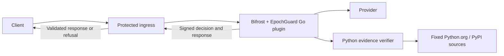

# EpochGuard

EpochGuard is an experimental verification gate for AI gateway responses. It holds a buffered answer until fixed evidence policies have checked every claim admitted by its bounded language, then releases the approved assistant content or refuses delivery.

Today it checks two propositions: the latest stable Python 3 release label on Python.org's Windows page, and the version reported for `requests` by the PyPI JSON API. The protected bounded-prose mode accepts nine exact sentence forms, not arbitrary natural language. Models can propose claim plans but cannot authorize answers.



- **ALLOW / 200:** every required claim is supported; deliver the exact approved assistant content in a minimal response envelope.
- **REJECT / 403:** an independently validated older-version contradiction; terminal refusal without the answer.
- **UNAVAILABLE / 503:** coverage, evidence, verifier or protected-receipt checks fail; no answer is released.

Genuine provider errors remain failures with their HTTP status and sanitized error fields; they are not verification verdicts.

## Run the offline demonstration

Requires Git, Docker Desktop with Linux containers and Buildx/Compose, and Python 3.12. Run from PowerShell:

```powershell
git clone https://github.com/aditya6927/epochguard.git
cd epochguard
py -3.12 tests/boundedprose/qualify.py --build --builder default
```

On Linux, replace `py -3.12` with `python3`. The host runner uses only the Python standard library. Image builds download pinned dependencies; the qualification itself uses **synthetic evidence and a controlled provider**, private networks, no published ports and no live credentials. It runs the real native Bifrost gateway and protected ingress, exercises delivery, refusals, receipt attacks and lifecycle failures, then removes its stack and signing-key volume. Sanitized runner/build outputs are written under ignored `artifacts/004g/qualification/`.

A successful run ends with `004G offline qualification passed; 004G LIVE QUALIFICATION PENDING`. This is a fixture demonstration, not a live factual observation. See [operations](docs/operations.md) for build prerequisites, troubleshooting, other profiles and regression commands. The default `compose.yaml` is a fixed-decision development fixture, not a factual verifier.

## Capability and qualification

| Capability | Status and limits |
| --- | --- |
| Protected bounded prose: `004g.v1` / `bounded-prose-v1` | **Implemented; qualified offline.** Independent Go/Python full-response parsing, two evidence policies, request-bound receipt v2, minimal metadata. **004G LIVE QUALIFICATION PENDING** |
| Exact-template multi-claim mode: `004b.v1` | **Qualified live within a narrow scope.** November 14, 2026 maintainer-authorized run used real Tavily/Python.org and PyPI, a controlled provider and explicitly legacy v1 ingress receipts. Subsequent report inspection found all five client expectations met; the runner collected results rather than declaring final live PASS |
| Legacy single-claim mode: `003a.v1` | **Qualified live within a narrow scope.** November 8, 2026 maintainer-supplied gateway run, one Python policy and controlled provider |
| Model-assisted claim planning | **Experimental, non-authorizing.** Draft annotations; model quality not independently qualified |
| Protected cache and atomic revocation | **Proposed, not implemented.** Built-in caching stays disabled in protected profiles |

The live multi-claim run recorded three attempted/completed application-level retrievals per source, not independent billing or origin-fetch counts. Its historical observations are not claims about today's versions. [Live evidence and measurement scope](docs/task-004e.md) and [security remediation evidence](docs/task-004gs.md) retain the exact results and limitations.

## Security boundary

The protected route is buffered `POST /openai/v1/chat/completions`. Ingress holds the full response and independently validates a policy-bound HMAC receipt. Current bounded-prose receipts bind the exact body forwarded by ingress to the body actually received by Bifrost, plus nonce, outcome, status and response/candidate digests. Provider metadata is discarded before signing; the approved content string is preserved exactly. Legacy profiles retain their documented v1 request-binding and metadata limitations.

The host, pinned gateway/plugin, Python verifier, clock, configuration, signing key and isolated network remain trusted. The private gateway-to-verifier hop is unauthenticated HTTP. Grammar coverage does not prove general semantic completeness; local observation age does not attest origin freshness. Direct gateways without ingress can serve unchecked content if the plugin is absent.

Streaming, arbitrary prose or sources, production providers/authentication, safe background execution, general route protection and production readiness remain unqualified. The native plugin requires the pinned dynamic Linux/amd64 build; stock static Bifrost binaries cannot load it as-is. See [architecture and trust boundaries](docs/architecture.md) for the complete contract and residual risks.

## Documentation

- [Architecture, capabilities and security contracts](docs/architecture.md)
- [Operations: builds, offline suites and explicit live workflows](docs/operations.md)
- [Verifier APIs, grammar, evidence and limits](services/verifier/README.md)
- [Experimental claim analysis](services/claim_analysis/README.md), [draft prose annotations](services/verifier/data/prose-v1/README.md) and [offline evaluation reports](services/verifier/reports/prose-v1/README.md)
- [Pinned Bifrost integration investigation](docs/bifrost-integration-spike.md)
- Decisions: [native plugin](docs/decisions/0001-native-bifrost-plugin.md), [typed refusals](docs/decisions/0002-buffered-response-enforcement.md), [proposed cache ownership](docs/decisions/0003-protected-cache-ownership.md)
- Contributor working agreement: [AGENTS.md](AGENTS.md)

Historical implementation and qualification reports remain under `docs/task-*.md`; start with [bounded prose](docs/task-004g.md), [request/metadata hardening](docs/task-004gs.md), [protected ingress](docs/task-004d.md) and [live multi-claim qualification](docs/task-004e.md). They record results at their stated revisions; architecture describes the current system.
