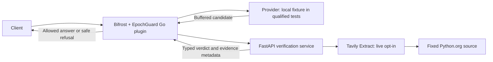

# EpochGuard

EpochGuard explores evidence-aware verification of time-sensitive AI answers and the prevention of unsafe reuse through stale caches. It places an enforcement boundary at the AI gateway: a buffered answer must receive a policy decision before the gateway can return it.

The broader goal is to connect answers to evidence, policy, and validity over time, including when an answer is reused from a cache. The current implementation is deliberately narrow: a native Go plugin for Bifrost, a Python/FastAPI verifier, and one explicit claim policy backed by Tavily Extract. An EpochGuard-owned verified cache is proposed, not implemented.

**Status:** experimental development software. Offline tests exercise the real gateway, plugin loader, and verification service with deterministic evidence fixtures. A passing full-policy live Tavily test has not been recorded. General factual verification and production readiness are not established.

## Why enforce at the gateway?

A plausible AI answer can become outdated when its subject changes. A response cache can then keep serving that answer after the original evidence or policy is no longer valid. A cache hit, similarity score, or unexpired TTL says something about reuse, not factual freshness.

Gateway enforcement lets the system hold a provider response while a verifier checks it, return a safe refusal when evidence is unavailable or contradictory, and prevent a policy refusal from silently triggering another model. Genuine provider failures retain their normal error and fallback behavior; a successful fallback answer must still pass evaluation.

Cache admission needs its own boundary. Experiments with Bifrost's built-in cache reproduced writes before verification, enforcement skipped on cache hits under incorrect plugin ordering, and pending writes repopulating deleted entries. Those findings motivate a future cache that owns verified admission and logical revocation. **Built-in caching remains disabled in the normal gateway and verification environments.**

## Architecture

The implemented request path holds candidate answer bytes inside Bifrost until the Go plugin accepts a decision:



Offline verification tests substitute a deterministic HTTP fixture for Tavily. The gateway, native plugin loader, FastAPI route, evidence comparison, and refusal path remain real. The live path is implemented but still needs a passing credentialed full-policy test.

| Component | Current state |
| --- | --- |
| Gateway enforcement | Implemented: synchronous decisions, typed refusals, cancellation/deadline handling, upstream-error preservation, and terminal policy refusals |
| Verification service | Implemented: one exact claim parser, explicit comparison rules, a typed contract, and bounded HTTP retrieval |
| Tavily integration | Implemented fixed-URL Extract client; no search ranking or LLM judge determines ALLOW |
| Evidence metadata | Implemented request/hash binding, source URL, content hash, retrieval identifier, observation timestamps, verdict, and reason codes; no durable evidence store |
| Verified response cache | Proposed: evidence/policy-bound admission, trusted identity scope, read-time validity checks, and atomic generation/version checks |
| Evidence persistence and revalidation | Proposed: retain evidence/decision state and recheck or revoke reusable answers when validity changes |
| Broader claim handling | Proposed: additional explicit policies, claim extraction, and time-sensitivity classification |

Bifrost is pinned to HTTP `transports/v2.4.0`. The development build compiles a dynamically linked Linux/amd64 gateway and the external Go `.so` with the same pinned toolchain and dependency graph, without modifying Bifrost core. This is not a drop-in extension for the default statically linked Bifrost binary. See the [architecture](docs/architecture.md) and [integration investigation](docs/bifrost-integration-spike.md).

EpochGuard waits for the verification decision inside Bifrost's `PostLLMHook`. Refusals return no provider response and use a typed `BifrostError` with further model fallback explicitly disabled.

## What can it verify today?

The only supported evidence policy accepts the entire assistant answer in this exact form:

```text
The latest stable Python 3 release for Windows listed on Python.org is X.Y.Z.
```

The version must be `3.<0..99>.<0..999>`, without leading zeros or prerelease suffixes. Extra claims, explanations, or instructions make the answer unsupported. Tavily retrieves only `https://www.python.org/downloads/windows/`; the verifier requires a unique latest-release label in the expected page context.

| Evidence outcome | Gateway decision | Client response |
| --- | --- | --- |
| Candidate matches the observed primary-page label | ALLOW | Original buffered answer |
| Candidate is numerically older than the observed label | REJECT | Safe HTTP 403; provider answer discarded |
| Candidate is newer, unsupported, ambiguous, or insufficiently evidenced; retrieval/verifier failure or timeout | UNAVAILABLE | Safe HTTP 503; provider answer discarded |

A newer candidate is unavailable because the extraction may lag a release announcement. Retrieval success alone never permits an answer. Retrieved instructions and model-generated text cannot select a decision. The candidate is sent to the internal verifier; it is not sent to Tavily.

This policy compares an extracted source label. It does not prove general truth or origin freshness. Observation timestamps record receipt of the extraction, not the page's publication time or Tavily's origin-fetch time. [Verification policy and contract details](docs/task-003a.md) describe the parsing rules, trust assumptions, and failure cases.

## Quick start: offline verification

You need Git, Docker Desktop running **Linux containers** or Docker Engine on Linux, and Docker Compose with `--wait` support. Builds target Linux/amd64 and use Buildx; other host architectures require emulation. No host Go/Python installation, paid model-provider key, or Tavily key is needed for offline tests. Initial builds require internet access to fetch source, images, and dependencies.

Clone the repository, then run the development commands from its root. These commands work in PowerShell and a Linux shell:

```sh
git clone https://github.com/aditya6927/epochguard.git
cd epochguard
docker compose build gateway
docker compose -f compose.verify.yaml build verifier-supported
docker compose -f compose.verify.yaml run --rm verification-tests
```

The native image build runs Go plugin unit tests and the race detector. The Python image build runs offline verifier tests. Building `verifier-supported` supplies the shared verifier image used by the other verification services.

The final command starts the required provider, evidence fixture, verifier services, and gateways, waits for their health checks, and runs acceptance tests. It exits nonzero on failure. The tests cover supported, contradicted, missing, ambiguous, timed-out, and malformed evidence; no-answer-leak checks; provider counters; fallback behavior; and streaming refusal. The isolated verification network publishes no host ports. Synthetic release numbers in its fixtures are not live factual evidence.

Inspect logs, then remove the disposable stack:

```sh
docker compose -f compose.verify.yaml logs gateway-supported verifier-supported
docker compose -f compose.verify.yaml down --remove-orphans
```

After changing code or configuration, stop the relevant stack, rebuild affected images, and restart it. Native plugins are loaded into the gateway process; replacing a `.so` file does not safely update a running gateway. Development configuration databases live in disposable containers.

If the default builder cannot resolve GitHub or the Go proxy, the repository includes an optional isolated DNS workaround:

```sh
docker buildx create --name epochguard-002a --driver docker-container --buildkitd-config dev/buildkitd.toml
docker compose build --builder epochguard-002a gateway
docker compose -f compose.verify.yaml build --builder epochguard-002a verifier-supported
```

Create that named builder once. Use an approved resolver instead on networks requiring corporate DNS. The historical builder/image names are retained for compatibility; see the [build notes](docs/task-002a.md#build-and-test).

## Development environments and testing

| Environment | Compose configuration | Purpose / exposure |
| --- | --- | --- |
| Offline evidence verification | [compose.verify.yaml](compose.verify.yaml) | Real gateway/service with deterministic evidence; internal network, no host ports |
| Deterministic enforcement demo | [compose.yaml](compose.yaml), `test` profile | Fixed ALLOW, REJECT, UNAVAILABLE, and no-plugin controls; ALLOW gateway on `127.0.0.1:8080` |
| Longer timeout qualification | Verification base + [compose.verify.timeouts.yaml](compose.verify.timeouts.yaml) | Slow evidence fixture using live-sized budgets; internal network, no host ports |
| Cache lifecycle experiments | [compose.cache.yaml](compose.cache.yaml) | Real Redis Stack and deliberately unsafe ordering/write controls; no host ports |
| Opt-in live retrieval | Verification base + [compose.verify.live.yaml](compose.verify.live.yaml) | Real Tavily, outbound network access, gateway on `127.0.0.1:8081` |

The default `compose.yaml` uses a **test-only fixed ALLOW** source for its published gateway. It does not check evidence or freshness. All environments use a controlled local OpenAI-compatible provider fixture; they do not qualify a production LLM provider.

### Gateway enforcement regression

After building the native image:

```sh
docker compose --profile test up -d --force-recreate --wait provider gateway gateway-control gateway-reject gateway-unavailable
docker compose --profile test run --rm --no-deps smoke
docker compose --profile test down --remove-orphans
```

The suite checks the real loader and hook execution, refusals without answer bytes, terminal fallback behavior, genuine upstream errors, concurrent requests, and usable no-plugin/SSE negative controls. Diagnostic `X-EpochGuard-*` headers report execution; they are not verification or authorization markers.

### Verifier tests and longer timeout qualification

Rerun the Python offline suite without network access:

```sh
docker run --rm --network none epochguard-verifier:003a python -m pytest -q -o cache_dir=/tmp/pytest-cache
```

Exercise the longer profile through the real gateway with a slow local evidence fixture:

```sh
docker compose -f compose.verify.yaml -f compose.verify.timeouts.yaml up -d --force-recreate --wait gateway-supported
docker compose -f compose.verify.yaml -f compose.verify.timeouts.yaml run --rm --no-deps verification-tests
docker compose -f compose.verify.yaml -f compose.verify.timeouts.yaml down --remove-orphans
```

The long-profile test is selected separately from the normal short-budget suite. It is an offline timeout experiment, not a live Tavily test or a performance benchmark.

### Cache lifecycle experiments

The cache stack enables Bifrost's built-in direct cache only for controlled experiments. It includes a Redis transport gate that makes pending-write/invalidation races reproducible. Its unsafe configurations are test controls, not deployment examples for protected traffic.

```sh
docker compose -f compose.cache.yaml up -d --wait provider store-proxy writer reader reject safe unavailable post-reject post-allow
docker compose -f compose.cache.yaml run --rm --no-deps cache-tests
docker compose -f compose.cache.yaml down --volumes --remove-orphans
```

These experiments establish cache lifecycle behavior, not factual freshness or atomic invalidation. Read the [cache findings](docs/task-002c.md) and [proposed cache ownership decision](docs/decisions/0003-protected-cache-ownership.md) before changing cache behavior.

## Configuration and credentials

Gateway/provider/plugin settings live under [dev/bifrost/](dev/bifrost/). Verification deployments mount the appropriate file from [dev/bifrost/verification/](dev/bifrost/verification/) read-only. These verification configurations place the native plugin `pre_builtin`, order `0`, with the built-in cache disabled. The HTTP source also sets server no-store as defense in depth, which does not make arbitrary cache configurations safe.

Offline sources explicitly use `test_only: true` and `evidence_mode: fixture`. The [live plugin configuration](dev/bifrost/verification/live.json) expects `tavily_live` evidence and cannot accept a fixture record as a successful live verdict. Verdicts, endpoints, and deadlines are trusted process configuration, never client header or prompt controls.

| Budget | Offline default | Live profile |
| --- | --- | --- |
| Tavily API timeout parameter | 3s | 19s |
| Whole retrieval | 4s | 20s |
| FastAPI verification work | 4.5s | 22s |
| Go verifier HTTP call | 6s | 25s |
| Gateway integration client | 12s | 30s |

`EPOCHGUARD_TIMEOUT_PROFILE` selects `offline` or `live`. The verifier supports bounded numeric overrides through `EPOCHGUARD_TAVILY_API_TIMEOUT_SECONDS`, `EPOCHGUARD_RETRIEVAL_TIMEOUT_SECONDS`, and `EPOCHGUARD_VERIFICATION_TIMEOUT_SECONDS`, requiring API < retrieval < verification. Go uses `verifier.timeout_ms`; the integration client uses `EPOCHGUARD_GATEWAY_CLIENT_TIMEOUT_MS`. Keep outer budgets aligned when customizing. The client budget also includes provider and queue time. See [timeout validation and Bifrost deadline findings](docs/task-003a.md#2026-11-07-follow-up-configurable-live-timeouts).

Offline Compose supplies fake fixture credentials. Live retrieval reads `TAVILY_API_KEY` from the verifier environment. The test endpoint override is restricted to explicit test mode and its designated fake credential. Do not commit real keys or print resolved live Compose configuration containing them.

## Opt-in live Tavily testing

A credentialed full-policy live pass remains unrecorded. The maintainer reported successful raw extraction and parsing, but the earlier full test exceeded its short deadline. The longer profile is available for follow-up; successful connectivity alone is not a verification verdict.

Build both images as in the quick start, then set `TAVILY_API_KEY` in your shell environment. For PowerShell, enter it without putting its value in command history:

```powershell
$tavilyKey = Read-Host 'Tavily API key' -AsSecureString
$env:TAVILY_API_KEY = [System.Net.NetworkCredential]::new('', $tavilyKey).Password
```

Explicitly select the live test and pass the environment variable by name:

```sh
docker run --rm -e EPOCHGUARD_RUN_LIVE_TAVILY=1 -e TAVILY_API_KEY epochguard-verifier:003a python -m pytest -m live -s -o cache_dir=/tmp/pytest-cache
```

This makes two real Extract calls and can consume Tavily credits. The first derives a candidate from the current primary label; the second goes through the full FastAPI policy without an injected retriever or verdict. It prints evidence metadata and checks the typed contract. No permanently hardcoded release version is used. This test exercises FastAPI and Tavily; the Go gateway is covered separately by offline integration tests.

To try the live-configured gateway with the local candidate-provider fixture:

```sh
docker compose -f compose.verify.yaml -f compose.verify.live.yaml up -d --wait gateway-supported
```

Only start `gateway-supported` in this configuration. Do not run the synthetic offline acceptance suite against live evidence. The inherited evidence fixture starts as a dependency but is unused by live retrieval. The gateway is available only on `127.0.0.1:8081`; there is no production provider or inference authentication.

For a PowerShell request, choose a candidate version to check. The provider fixture returns this sentence verbatim so the verifier can evaluate it:

```powershell
$candidateVersion = Read-Host 'Stable version to check (3.x.y)'
$body = @{
    model = 'fixture/epochguard-test'
    stream = $false
    messages = @(@{
        role = 'user'
        content = "The latest stable Python 3 release for Windows listed on Python.org is ${candidateVersion}."
    })
} | ConvertTo-Json -Depth 4
Invoke-RestMethod -Uri http://127.0.0.1:8081/openai/v1/chat/completions -Method Post -ContentType application/json -Body $body -TimeoutSec 30
```

The result can be an allowed answer, 403 contradiction refusal, or 503 unavailable refusal. Stop the live stack, then clear the key when finished:

```sh
docker compose -f compose.verify.yaml -f compose.verify.live.yaml down --remove-orphans
```

```powershell
Remove-Item Env:TAVILY_API_KEY
Remove-Variable tavilyKey
```

## Supported surface and limitations

- The qualified inference route is buffered `POST /openai/v1/chat/completions`. Streaming and asynchronous requests are refused before provider dispatch; safe streaming delivery is not implemented. Other inference routes, direct SDK calls, and alternate transports are not qualified.
- Evidence verification requires one complete plain assistant choice with finish reason `stop`. Tools, reasoning extensions, multimodal content, multiple choices, partial completions, and additional claims are unsupported.
- Timeouts, cancellation, invalid contracts, and insufficient evidence fail closed while the plugin is active. Refusals discard the provider answer and disallow model fallback. Genuine upstream errors are preserved rather than treated as successful candidates.
- A missing or failed-to-load plugin can leave Bifrost healthy and serving. Tests detect this condition; an external ready-to-serve gate is not implemented. `/health` and diagnostic headers do not establish protection.
- Development inference authentication is disabled. The public development setup token authenticates management probes only. Keep published gateways on loopback; the verifier hop, configuration, management access, and sibling plugins are trusted development inputs. Production authentication and deployment hardening remain work to do.
- There is no protected response cache, durable evidence database, revalidation worker, dashboard, or general factual verifier. Tavily/source lag, source compromise, layout changes, and clock assumptions limit the narrow policy. Detailed reports document the exact checks and remaining gaps.

## Roadmap

The documented design directions are:

1. Complete and record credentialed full-policy live qualification, retaining explicit evidence and failure semantics.
2. Develop additional bounded verification policies and the proposed claim-extraction/time-sensitivity components with their own acceptance criteria.
3. Implement evidence persistence and an EpochGuard-owned verified cache, including trusted scope, policy/evidence validity, and atomic admission/revocation checks described in ADR 0003.
4. Add revalidation/invalidation workflows, and qualify concurrency, outages, and stale-writer races before claiming safe reuse.
5. Add production authentication and a readiness gate; qualify additional providers and request modes before expanding the supported surface.

These are plans, not delivered capabilities or a release schedule.

## Repository guide and documentation

| Path | Purpose |
| --- | --- |
| [plugins/epochguard/](plugins/epochguard/) | Native Go enforcement plugin and unit tests |
| [services/verifier/](services/verifier/) | FastAPI service, typed evidence policy, Tavily client, offline/live tests |
| [cmd/provider-fixture/](cmd/provider-fixture/) | Controlled OpenAI-compatible provider |
| [tests/smoke/](tests/smoke/) and [tests/verification/](tests/verification/) | Real gateway enforcement and verification acceptance suites |
| [tests/cachelifecycle/](tests/cachelifecycle/) and [cmd/cache-store-proxy/](cmd/cache-store-proxy/) | Cache lifecycle tests and deterministic write scheduling |
| [dev/](dev/) | Pinned native build, gateway configurations, fixture catalogs, builder settings |

Start with the [architecture](docs/architecture.md), [upstream integration investigation](docs/bifrost-integration-spike.md), and [contributor working agreement](AGENTS.md). Keep the plugin's shared dependency graph aligned with the gateway; do not run `go mod tidy` on it in isolation. The native build checks that alignment.

Design decisions:

- [Native Bifrost integration](docs/decisions/0001-native-bifrost-plugin.md)
- [Typed buffered-response enforcement](docs/decisions/0002-buffered-response-enforcement.md)
- [Proposed verified cache admission and logical revocation](docs/decisions/0003-protected-cache-ownership.md)

Development history and executed evidence:

- [Native loader and build qualification](docs/task-002a.md)
- [Response enforcement, fallback, and no-leak tests](docs/task-002b.md)
- [Real cache ordering, invalidation, and race experiments](docs/task-002c.md)
- [Narrow evidence policy, live-test status, and timeout follow-up](docs/task-003a.md)

The reports retain exact commands, results, limitations, and historical scope. Current implementation status is summarized above; detailed milestone reports remain in `docs/`.
