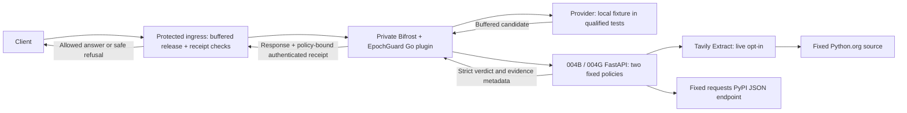

# EpochGuard

EpochGuard explores evidence-aware verification of time-sensitive AI answers and the prevention of unsafe reuse through stale caches. It places an enforcement boundary at the AI gateway: a buffered answer must receive a policy decision before the gateway can return it.

The broader goal is to connect answers to evidence, policy, and validity over time, including when an answer is reused from a cache. The current implementation is deliberately narrow: a native Go plugin for Bifrost, a Python/FastAPI verifier and an experimental protected ingress. Its multi-claim and bounded-prose profiles check two fixed policies: the Python.org Windows release label through Tavily Extract and the version reported for requests by the PyPI JSON API. The original single-policy `003a.v1` route remains available and unchanged. An EpochGuard-owned verified cache is proposed, not implemented.

**Status:** experimental development software. [Task 004G](docs/task-004g.md) adds an isolated, offline-qualified bounded-prose mode: nine finite sentence forms, independent whole-response parsing in Go/Python and policy-bound protected receipts. [004G-S security hardening](docs/task-004gs.md) requires `004g.receipt.v2`, binds exact forwarded request bytes, and removes provider-owned metadata before signing G responses. Approved assistant content is preserved exactly; the G JSON envelope is intentionally minimal. Legacy D/E profiles retain explicitly configured `004d.v1` behavior and its documented limits. **004G LIVE QUALIFICATION PENDING.** The 004F model planner remains non-authorizing. The maintainer-authorized **November 14, 2026 protected live multi-claim run met its narrow acceptance checks**, based on subsequent inspection of its reports: unchanged two-claim delivery, contradiction/unsupported/missing-plugin refusals and preserved genuine provider error. This qualified the authenticated ingress release boundary and real Tavily/PyPI retrieval path together under exact-template restrictions, using a controlled provider. The [004E report](docs/task-004e.md) distinguishes collected data, successful client expectations and report assessment; the runner did not print a final live PASS. General factual verification, commercial LLM providers, production readiness/authentication and protected caching remain unqualified. The [earlier single-policy result](docs/task-003b.md) retains its own historical scope.

## Why enforce at the gateway?

A plausible AI answer can become outdated when its subject changes. A response cache can then keep serving that answer after the original evidence or policy is no longer valid. A cache hit, similarity score, or unexpired TTL says something about reuse, not factual freshness.

Gateway enforcement lets the system hold a provider response while a verifier checks it, return a safe refusal when evidence is unavailable or contradictory, and prevent a policy refusal from silently triggering another model. Genuine provider failures retain their normal error and fallback behavior; a successful fallback answer must still pass evaluation.

Cache admission needs its own boundary. Experiments with Bifrost's built-in cache reproduced writes before verification, enforcement skipped on cache hits under incorrect plugin ordering, and pending writes repopulating deleted entries. Those findings motivate a future cache that owns verified admission and logical revocation. **Built-in caching remains disabled in the normal gateway and verification environments.**

## Architecture

The protected multi-claim path holds candidate answer bytes until Go validates the evidence decision and ingress authenticates the response receipt:



Offline tests substitute deterministic evidence for the external sources while retaining the real gateway, plugin loader, verifier and refusal path. The separate legacy deployment checks one Python claim through `/v1/verify`; the existing protected profile uses `/v1/verify/multiclaim`; the separate 004G profile uses `/v1/verify/prose`. Neither path uses model classifications to authorize release.

| Component | Current state |
| --- | --- |
| Gateway enforcement | Implemented: synchronous decisions, typed refusals, cancellation/deadline handling, upstream-error preservation, and terminal policy refusals |
| Protected ingress | Experimental isolated profile: authenticated per-response receipts, buffered release, private gateway networking and independent readiness; qualified with the narrow live multi-claim path |
| Verification service | Two fixed policies under whole-response template or finite prose coverage and independent Go validation; unchanged single-policy legacy endpoint also available |
| Tavily integration | Implemented fixed-URL Extract client; no search ranking or LLM judge determines ALLOW |
| Evidence metadata | Implemented request/hash binding, source URL, content hash, retrieval identifier, observation timestamps, verdict, and reason codes; no durable evidence store |
| Verified response cache | Proposed: evidence/policy-bound admission, trusted identity scope, read-time validity checks, and atomic generation/version checks |
| Evidence persistence and revalidation | Proposed: retain evidence/decision state and recheck or revoke reusable answers when validity changes |
| Claim identification | Standalone experimental baseline/model adapter and draft evaluation set; not connected to gateway verification; human label review and real-model quality qualification pending |
| Broader verification | Exact-template and nine-form bounded-prose enforcement; unrestricted natural-language verification remains unqualified |

Bifrost is pinned to HTTP `transports/v2.4.0`. The development build compiles a dynamically linked Linux/amd64 gateway and the external Go `.so` with the same pinned toolchain and dependency graph, without modifying Bifrost core. This is not a drop-in extension for the default statically linked Bifrost binary. See the [architecture](docs/architecture.md) and [integration investigation](docs/bifrost-integration-spike.md).

EpochGuard waits for the verification decision inside Bifrost's `PostLLMHook`. Refusals return no provider response and use a typed `BifrostError` with further model fallback explicitly disabled.

## What can it verify today?

The experimental `004b.v1` grammar admits one to eight exact sentences selected from these two forms; the live qualification exercised a two-claim answer:

```text
The latest stable Python 3 release for Windows listed on Python.org is X.Y.Z.
The version reported for requests by the PyPI JSON API is X.Y.Z.
```

Python versions must be `3.<0..99>.<0..999>`; PyPI versions have three components, each `0..999`, without leading zeros or suffixes. Every required claim must be accounted for; prose, instructions or content outside the grammar prevent support. Tavily retrieves only `https://www.python.org/downloads/windows/`, requiring a unique release label in the expected context. PyPI retrieval uses only `https://pypi.org/pypi/requests/json`, requiring the exact project identity, canonical reported version and non-yanked metadata. See the [verifier grammar and policy rules](services/verifier/README.md).

The isolated `004g.v1` / `bounded-prose-v1` mode additionally admits the seven [004F paraphrases](docs/task-004g.md#exact-grammar), for example:

```text
Python.org currently lists Python 3.15.2 as its latest stable Windows release.
PyPI reports requests version 2.34.2.
```

These are synthetic fixture versions. Both policies must have supporting evidence; extra prose, greetings, compounds and semantic variations fail closed. This mode has offline real-gateway qualification, not live or unrestricted prose qualification. Reproduce it with `& .venv-003a/Scripts/python.exe tests/boundedprose/qualify.py --build` in PowerShell (the existing verifier environment is required for this host driver). No API credentials are needed.

The unchanged `003a.v1` legacy mode accepts only the single exact Python sentence as the entire answer, with its original bounds. Multi-claim support requires explicitly selected trusted configuration.

| Evidence outcome | Gateway decision | Client response |
| --- | --- | --- |
| Every required claim matches its validated source observation under complete coverage | ALLOW | Original buffered answer |
| An independently validated claim is numerically older than its observed source version | REJECT | Safe HTTP 403; provider answer discarded |
| Candidate is newer, unsupported, ambiguous, or insufficiently evidenced; retrieval/verifier failure or timeout | UNAVAILABLE | Safe HTTP 503; provider answer discarded |

A newer claim is insufficiently established by that observation; the Python extraction may lag a release announcement. Retrieval success alone never permits an answer. Retrieved instructions and model-generated text cannot select a decision. The candidate is sent to the internal verifier; it is not sent to either evidence source.

These policies compare an extracted label or reported package metadata. They do not prove general truth or origin freshness. Observation timestamps record local receipt, not source publication time or Tavily's origin-fetch time. The [legacy policy](docs/task-003a.md) and [multi-claim rules](services/verifier/README.md) describe their trust assumptions and failure cases.

## Experimental claim identification

A separate [Python analyzer and evaluation CLI](services/claim_analysis/README.md) identifies verbatim claim spans and temporal evidence requirements in ordinary responses. It includes a deterministic baseline, a bounded opt-in Gemini adapter, and 112 synthetic draft examples with 184 factual annotations. Independent human review and real-model performance qualification remain pending. The baseline's low held-out fresh-evidence recall is recorded in [the evaluation report](docs/task-004a.md). Identification is not verification and cannot authorize delivery; gateway verification remains restricted to the fixed policies and finite sentence forms above.

## Quick start: offline verification

An [experimental multi-claim API and isolated gateway demo](services/verifier/README.md)
checks exact Python Windows and fixed-package PyPI claims under a whole-response
grammar. Every required claim needs evidence; unaccounted content prevents
SUPPORTED. Its explicitly configured `004b.v1` mode adds independent Go coverage
and contract checks. Existing `003a.v1` deployments keep their current behavior;
the 004C demo itself qualifies synthetic fixtures. The protected live profile has
the separate acceptance evidence described below.

A separate [protected-ingress demonstration](docs/task-004d.md) places Bifrost on
a private network and releases responses only after checking a nonce-bound HMAC
receipt from the active enforcement path. Missing or disabled plugins cannot
silently restore unchecked delivery through that entry point. Its original 004D
offline qualification includes runtime disable, restart and forged/replayed receipts;
existing deployments are unchanged, and production authentication remains work
to do. The report includes a reproducible host-Python lifecycle driver.

An [opt-in live multi-claim profile](docs/task-004e.md) connects this protected
path to the fixed Tavily/Python.org and PyPI sources, with bounded call budgets,
longer trusted deadlines and readiness that consumes no source credits. The
November 14 maintainer run and report assessment qualified that complete narrow
path. The report provides a credential-free `--build` reproduction and a
separately authorized `--live` command using a temporary runtime secret file.

You need Git, Docker Desktop running **Linux containers** or Docker Engine on Linux, and Docker Compose with `--wait` support. Builds target Linux/amd64 and use Buildx; other host architectures require emulation. The development commands below need no host Go/Python installation, paid model-provider key, or Tavily key. Initial builds require internet access to fetch source, images, and dependencies.

Clone the repository, then run the development commands from its root. These commands work in PowerShell and a Linux shell:

```sh
git clone https://github.com/aditya6927/epochguard.git
cd epochguard
docker compose build gateway
docker compose -f compose.verify.yaml build verifier-supported
docker compose -f compose.verify.yaml run --rm verification-tests
```

The native image build runs Go plugin unit tests and the race detector. The Python image build runs offline verifier tests. Building `verifier-supported` supplies the shared verifier image used by the other verification services.

The final command starts the required provider, evidence fixture, verifier services, and gateways, waits for their health checks, and runs acceptance tests. It exits nonzero on failure. The tests cover supported, contradicted, missing, ambiguous, timed-out, and malformed evidence; no-answer-leak checks; provider counters; fallback behavior; and streaming refusal. The isolated verification network publishes no host ports. Synthetic release numbers in its fixtures are not live factual evidence.

Inspect logs, then remove the disposable stack:

```sh
docker compose -f compose.verify.yaml logs gateway-supported verifier-supported
docker compose -f compose.verify.yaml down --remove-orphans
```

After changing code or configuration, stop the relevant stack, rebuild affected images, and restart it. Native plugins are loaded into the gateway process; replacing a `.so` file does not safely update a running gateway. Development configuration databases live in disposable containers.

If the default builder cannot resolve GitHub or the Go proxy, the repository includes an optional isolated DNS workaround:

```sh
docker buildx create --name epochguard-002a --driver docker-container --buildkitd-config dev/buildkitd.toml
docker compose build --builder epochguard-002a gateway
docker compose -f compose.verify.yaml build --builder epochguard-002a verifier-supported
```

Create that named builder once. Use an approved resolver instead on networks requiring corporate DNS. The historical builder/image names are retained for compatibility; see the [build notes](docs/task-002a.md#build-and-test).

## Development environments and testing

| Environment | Compose configuration | Purpose / exposure |
| --- | --- | --- |
| Protected bounded-prose offline qualification | [compose.verify.004g.yaml](compose.verify.004g.yaml) | Nine sentence forms, independent parsing and policy-bound receipts; internal networks, no host ports or live calls |
| Protected multi-claim offline qualification | [compose.verify.004e.offline.yaml](compose.verify.004e.offline.yaml) | Two fixed policies, protected ingress and simulated source failures; internal networks, no host ports |
| Opt-in protected live multi-claim qualification | [compose.verify.004e.yaml](compose.verify.004e.yaml) | Real Tavily/PyPI evidence through receipt-gated ingress; verifier-only egress, runtime secret file, no host ports |
| Offline evidence verification | [compose.verify.yaml](compose.verify.yaml) | Real gateway/service with deterministic evidence; internal network, no host ports |
| Deterministic enforcement demo | [compose.yaml](compose.yaml), `test` profile | Fixed ALLOW, REJECT, UNAVAILABLE, and no-plugin controls; ALLOW gateway on `127.0.0.1:8080` |
| Longer timeout qualification | Verification base + [compose.verify.timeouts.yaml](compose.verify.timeouts.yaml) | Slow evidence fixture using live-sized budgets; internal network, no host ports |
| Cache lifecycle experiments | [compose.cache.yaml](compose.cache.yaml) | Real Redis Stack and deliberately unsafe ordering/write controls; no host ports |
| Legacy opt-in single-policy live retrieval | Verification base + [compose.verify.live.yaml](compose.verify.live.yaml) | Real Tavily, outbound network access, gateway on `127.0.0.1:8081`; separate from protected ingress |

The default `compose.yaml` uses a **test-only fixed ALLOW** source for its published gateway. It does not check evidence or freshness. All environments use a controlled local OpenAI-compatible provider fixture; they do not qualify a production LLM provider.

### Gateway enforcement regression

After building the native image:

```sh
docker compose --profile test up -d --force-recreate --wait provider gateway gateway-control gateway-reject gateway-unavailable
docker compose --profile test run --rm --no-deps smoke
docker compose --profile test down --remove-orphans
```

The suite checks the real loader and hook execution, refusals without answer bytes, terminal fallback behavior, genuine upstream errors, concurrent requests, and usable no-plugin/SSE negative controls. Diagnostic `X-EpochGuard-*` headers report execution; they are not verification or authorization markers. The protected ingress uses a separate authenticated per-response receipt, not those diagnostics.

### Verifier tests and longer timeout qualification

Rerun the Python offline suite without network access:

```sh
docker run --rm --network none epochguard-verifier:003a python -m pytest -q -o cache_dir=/tmp/pytest-cache
```

Exercise the longer profile through the real gateway with a slow local evidence fixture:

```sh
docker compose -f compose.verify.yaml -f compose.verify.timeouts.yaml up -d --force-recreate --wait gateway-supported
docker compose -f compose.verify.yaml -f compose.verify.timeouts.yaml run --rm --no-deps verification-tests
docker compose -f compose.verify.yaml -f compose.verify.timeouts.yaml down --remove-orphans
```

The long-profile test is selected separately from the normal short-budget suite. It is an offline timeout experiment, not a live Tavily test or a performance benchmark.

### Cache lifecycle experiments

The cache stack enables Bifrost's built-in direct cache only for controlled experiments. It includes a Redis transport gate that makes pending-write/invalidation races reproducible. Its unsafe configurations are test controls, not deployment examples for protected traffic.

```sh
docker compose -f compose.cache.yaml up -d --wait provider store-proxy writer reader reject safe unavailable post-reject post-allow
docker compose -f compose.cache.yaml run --rm --no-deps cache-tests
docker compose -f compose.cache.yaml down --volumes --remove-orphans
```

These experiments establish cache lifecycle behavior, not factual freshness or atomic invalidation. Read the [cache findings](docs/task-002c.md) and [proposed cache ownership decision](docs/decisions/0003-protected-cache-ownership.md) before changing cache behavior.

## Configuration and credentials

Gateway/provider/plugin settings live under [dev/bifrost/](dev/bifrost/). Verification deployments mount the appropriate file from [dev/bifrost/verification/](dev/bifrost/verification/) read-only. These verification configurations place the native plugin `pre_builtin`, order `0`, with the built-in cache disabled. The HTTP source also sets server no-store as defense in depth, which does not make arbitrary cache configurations safe.

Protected deployments additionally use [dev/ingress/](dev/ingress/) or
[dev/live/](dev/live/). The 004E profile requires explicit live opt-in and a
verifier-only runtime Tavily secret file, separate from the ingress/signing key.
It uses fixed live deadlines and source-free readiness; see the
[complete budget and PowerShell setup](docs/task-004e.md). The following settings
and environment-key instructions apply to the unchanged legacy 003A profiles.

Offline sources explicitly use `test_only: true` and `evidence_mode: fixture`. The [live plugin configuration](dev/bifrost/verification/live.json) expects `tavily_live` evidence and cannot accept a fixture record as a successful live verdict. Verdicts, endpoints, and deadlines are trusted process configuration, never client header or prompt controls.

| Legacy 003A budget | Offline default | Opt-in live profile |
| --- | --- | --- |
| Tavily API timeout parameter | 3s | 19s |
| Whole retrieval | 4s | 20s |
| FastAPI verification work | 4.5s | 22s |
| Go verifier HTTP call | 6s | 25s |
| Gateway integration client | 12s | 30s |

`EPOCHGUARD_TIMEOUT_PROFILE` selects `offline` or `live`. The verifier supports bounded numeric overrides through `EPOCHGUARD_TAVILY_API_TIMEOUT_SECONDS`, `EPOCHGUARD_RETRIEVAL_TIMEOUT_SECONDS`, and `EPOCHGUARD_VERIFICATION_TIMEOUT_SECONDS`, requiring API < retrieval < verification. Go uses `verifier.timeout_ms`; the integration client uses `EPOCHGUARD_GATEWAY_CLIENT_TIMEOUT_MS`. Keep outer budgets aligned when customizing. The client budget also includes provider and queue time. See [timeout validation and Bifrost deadline findings](docs/task-003a.md#2026-11-07-follow-up-configurable-live-timeouts).

Offline Compose supplies fake fixture credentials. Live retrieval reads `TAVILY_API_KEY` from the verifier environment. The test endpoint override is restricted to explicit test mode and its designated fake credential. Do not commit real keys or print resolved live Compose configuration containing them.

## Legacy single-policy live Tavily testing

For the protected two-policy qualification, use the [004E instructions](docs/task-004e.md).
The following commands exercise the separate legacy path and do not add the
authenticated ingress boundary.

The maintainer reports passing credentialed FastAPI policy and full narrow gateway tests. The [gateway qualification report](docs/task-003b.md) records the successful November 8 rerun after supplying a working credential and recreating the stack, while preserving the earlier 401 attempts. The exact original credential mismatch remains unproven. Qualification remains limited to the existing single policy and local provider fixture; successful connectivity alone is not a verification verdict.

Build both images as in the quick start, then set `TAVILY_API_KEY` in your shell environment. For PowerShell, enter it without putting its value in command history:

```powershell
$tavilyKey = Read-Host 'Tavily API key' -AsSecureString
$env:TAVILY_API_KEY = [System.Net.NetworkCredential]::new('', $tavilyKey).Password
```

Explicitly select the live test and pass the environment variable by name:

```sh
docker run --rm -e EPOCHGUARD_RUN_LIVE_TAVILY=1 -e TAVILY_API_KEY epochguard-verifier:003a python -m pytest -m live -s -o cache_dir=/tmp/pytest-cache
```

This makes two real Extract calls and can consume Tavily credits. The first derives a candidate from the current primary label; the second goes through the full FastAPI policy without an injected retriever or verdict. It prints evidence metadata and checks the typed contract. No permanently hardcoded release version is used. This test exercises FastAPI and Tavily; the Go gateway is covered separately by offline integration tests.

To try the live-configured gateway with the local candidate-provider fixture:

```sh
docker compose -f compose.verify.yaml -f compose.verify.live.yaml up -d --wait gateway-supported
```

Only start `gateway-supported` in this configuration. The inherited evidence fixture starts as a dependency but is unused by live retrieval. The gateway is available only on `127.0.0.1:8081`; there is no production provider or inference authentication.

Explicitly run the live gateway qualification after startup:

```sh
docker compose -f compose.verify.yaml -f compose.verify.live.yaml run --rm --no-deps -e EPOCHGUARD_RUN_LIVE_TAVILY=1 verification-tests
```

The live override selects only the live gateway test. It first checks actual plugin placement and cache absence, then makes one direct verifier observation to derive a candidate version and checks supported and older claims through Bifrost. A successful run makes up to three extraction calls. The runner receives no Tavily key. Unsupported claims, upstream errors, streaming refusal, no-answer leakage, provider counts, and forged bypass/deadline headers are checked as described in the report. Live retrieval counts are not exposed; zero-retrieval controls are measured in the offline suite. Do not run synthetic offline expectations against the live verifier. A skipped test without opt-in is not live qualification.

For a PowerShell request, choose a candidate version to check. The provider fixture returns this sentence verbatim so the verifier can evaluate it:

```powershell
$candidateVersion = Read-Host 'Stable version to check (3.x.y)'
$body = @{
    model = 'fixture/epochguard-test'
    stream = $false
    messages = @(@{
        role = 'user'
        content = "The latest stable Python 3 release for Windows listed on Python.org is ${candidateVersion}."
    })
} | ConvertTo-Json -Depth 4
Invoke-RestMethod -Uri http://127.0.0.1:8081/openai/v1/chat/completions -Method Post -ContentType application/json -Body $body -TimeoutSec 30
```

The result can be an allowed answer, 403 contradiction refusal, or 503 unavailable refusal. Stop the live stack, then clear the key when finished:

```sh
docker compose -f compose.verify.yaml -f compose.verify.live.yaml down --remove-orphans
```

```powershell
Remove-Item Env:TAVILY_API_KEY
Remove-Variable tavilyKey
```

## Supported surface and limitations

- The qualified inference route is buffered `POST /openai/v1/chat/completions`. Streaming and asynchronous requests are refused before provider dispatch; safe streaming delivery is not implemented. Other inference routes, direct SDK calls, and alternate transports are not qualified.
- The [HTTP route audit](docs/task-003c.md) tests all eight registered passthrough prefixes and raw path variants against the pinned gateway. Tested passthrough, Responses, realtime/live and relay requests are refused before dispatch. Management routes bypass the HTTP transport hook: configured Warp chat is stopped by the core request-type guard, but wraps that refusal in HTTP 200 JSON/SSE. Warp background jobs can explicitly skip plugins and remain outside this qualification. Keep management/configuration trusted; the plugin is not an all-route ingress firewall.
- Evidence verification requires one complete plain assistant choice with finish reason `stop`. Tools, reasoning extensions, multimodal content, multiple choices, partial completions and content outside the selected policy grammar are unsupported. The legacy mode covers one Python sentence; the experimental profile covers only its two fixed template policies.
- Timeouts, cancellation, invalid contracts, and insufficient evidence fail closed while the plugin is active. Refusals discard the provider answer and disallow model fallback. Genuine upstream errors are preserved rather than treated as successful candidates.
- A missing or failed-to-load plugin can leave direct Bifrost deployments healthy and serving. The separate protected-ingress profile refuses responses without valid enforcement receipts and checks readiness independently. `/health` and unsigned diagnostic headers alone do not establish protection.
- Development inference authentication is disabled. The public development setup token authenticates management probes only. Keep published gateways on loopback; protected profiles publish no host ports. The private gateway-to-verifier HTTP hop lacks independent authentication; configuration, management access and sibling plugins remain trusted inputs. Production authentication and deployment hardening remain work to do.
- There is no protected response cache, durable evidence database, revalidation worker, dashboard, or general factual verifier. Tavily/source lag, source compromise, layout changes, and clock assumptions limit the narrow policy. Detailed reports document the exact checks and remaining gaps.

## Roadmap

The documented design directions are:

1. Develop additional bounded verification policies and the proposed claim-extraction/time-sensitivity components with their own acceptance criteria.
2. Implement evidence persistence and an EpochGuard-owned verified cache, including trusted scope, policy/evidence validity, and atomic admission/revocation checks described in ADR 0003.
3. Add revalidation/invalidation workflows, and qualify concurrency, outages, and stale-writer races before claiming safe reuse.
4. Add production authentication and qualify deployment readiness beyond the experimental protected ingress; qualify additional providers and request modes before expanding the supported surface.

These are plans, not delivered capabilities or a release schedule.

## Repository guide and documentation

| Path | Purpose |
| --- | --- |
| [plugins/epochguard/](plugins/epochguard/) | Native Go enforcement plugin and unit tests |
| [services/verifier/](services/verifier/) | Legacy and multi-claim FastAPI endpoints, two fixed policies, Tavily/PyPI clients, offline/live tests |
| [internal/ingress/](internal/ingress/) and [cmd/protected-ingress/](cmd/protected-ingress/) | Buffered receipt-gated release and independent protected readiness |
| [cmd/provider-fixture/](cmd/provider-fixture/) | Controlled OpenAI-compatible provider |
| [tests/smoke/](tests/smoke/) and [tests/verification/](tests/verification/) | Real gateway enforcement and verification acceptance suites |
| [tests/multiclaim/](tests/multiclaim/) and [tests/protectedingress/](tests/protectedingress/) | Multi-claim enforcement, receipt attacks and protected lifecycle qualification |
| [tests/livequalification/](tests/livequalification/) and [services/verifier/tests_live/](services/verifier/tests_live/) | Bounded live/offline driver, client/operator runners and simulated source controls |
| [tests/cachelifecycle/](tests/cachelifecycle/) and [cmd/cache-store-proxy/](cmd/cache-store-proxy/) | Cache lifecycle tests and deterministic write scheduling |
| [dev/](dev/) | Pinned native build, gateway configurations, fixture catalogs, builder settings |

Start with the [architecture](docs/architecture.md), [upstream integration investigation](docs/bifrost-integration-spike.md), and [contributor working agreement](AGENTS.md). Keep the plugin's shared dependency graph aligned with the gateway; do not run `go mod tidy` on it in isolation. The native build checks that alignment.

Design decisions:

- [Native Bifrost integration](docs/decisions/0001-native-bifrost-plugin.md)
- [Typed buffered-response enforcement](docs/decisions/0002-buffered-response-enforcement.md)
- [Proposed verified cache admission and logical revocation](docs/decisions/0003-protected-cache-ownership.md)

Development history and executed evidence:

- [Native loader and build qualification](docs/task-002a.md)
- [Response enforcement, fallback, and no-leak tests](docs/task-002b.md)
- [Real cache ordering, invalidation, and race experiments](docs/task-002c.md)
- [Narrow evidence policy, live-test status, and timeout follow-up](docs/task-003a.md)
- [Live gateway qualification and observed limits](docs/task-003b.md)
- [HTTP routes, raw paths, and management enforcement boundaries](docs/task-003c.md)
- [004A: experimental claim identification and evaluation](docs/task-004a.md)
- [004A-H: claim-analysis contract and diagnostic hardening](docs/task-004a-hardening.md)
- [004B: deterministic two-policy whole-response verification](docs/task-004b.md)
- [004C: independent Go validation and fixture gateway qualification](docs/task-004c.md)
- [004D: authenticated protected ingress and deployment integrity](docs/task-004d.md)
- [004E: protected live two-source qualification and report assessment](docs/task-004e.md)

The reports retain exact commands, results, limitations, and historical scope. Current implementation status is summarized above; detailed milestone reports remain in `docs/`.
