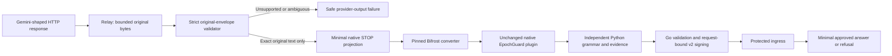

# Task 005C-T — safe pre-conversion Gemini response adapter

## Reviewed real-model qualification — November 19, 2026

**NARROW REAL-MODEL ENFORCEMENT QUALIFICATION MET.** The separately authorized November 19 run demonstrated policy-bounded enforcement of genuine Gemini-generated candidates through strict pre-conversion structural validation, pinned Bifrost conversion, native Go plugin enforcement, independent Python verification, request-bound receipt signing and protected ingress. The supported answer was released unchanged; contradicted and unsupported answers were withheld. Evidence retrieval was **simulated** throughout. This assessment applies only to the tested configuration and evidence mode.

This subsequent review inspected existing sanitized operator-collected records, without repeating provider calls. The original live report still says `PENDING INDEPENDENT REVIEW` and `COLLECTED; NOT APPROVED`: those collection-time fields remain unchanged. The implementation-time pending status and original testing details in the remaining sections are preserved as chronological evidence. The two November 18 failed real-model attempts remain unchanged; this adapter was not present in those runs.

### Qualification identity and evidence

| Field | Reviewed value |
| --- | --- |
| Qualification schema / run | `005c.gateway.v1` / `20261119T092712Z-6d95a336` |
| Date | November 19, 2026 |
| Implementation / source revision | `87d877c43f3ab46d9d62d279e457f16b8df9c0c3` |
| Source SHA-256 | `816a776a6eaad8533dbc0cb84b1c9cf32e84168a8beb4ce6f745416c96a0a793` |
| Live configuration SHA-256 | `4b96205612c9ee5bdb38150224e0f8ef7cadcd2d01be6820b4ac195ae1d3f124` |
| Model / provider | `gemini-3.5-flash-lite` / native Gemini through pinned Bifrost |
| Response mode | `strict-005ct` |
| Evidence / policy / receipt | Simulated / `004g.v1/bounded-prose-v1` / `004g.receipt.v2` |
| Real Gemini submissions / completed responses | 4 / 4 HTTP 200 |
| Expected protected client outcomes | 6/6 |
| Cleanup | Completed; recorded cleanup stage exit 0 |

The strict offline preflight is `artifacts/005c/offline/20261119T092144Z-eb3be78f/`; the reviewed real-model run is `artifacts/005c/live/20261119T092712Z-6d95a336/`. Both contain `report.json`, `observations.json`, `client.json`, `stages.json` and public qualification configuration. Both reports identify the same source revision/digest and strict response mode; the offline report has `offline_passed: true` and eight expected policy/provider/ingress outcomes. The live report's `offline_passed: false` identifies a live collection, not a failed preflight. Both record completed cleanup, and every recorded orchestration stage exited 0. No separate cleanup file exists in these directories; cleanup evidence is in the reports and stages.

### Reviewed protected outcomes and verifier decisions

| Scenario | HTTP | Outcome | Answer released | Protected client elapsed |
| --- | --- | --- | --- | --- |
| Supported | 200 | ALLOW | Yes | 9003.188 ms |
| Older version | 403 | REJECT | No | 8785.892 ms |
| Unsupported factual prose | 503 | UNAVAILABLE | No | 6095.623 ms |
| Unrecognized paraphrase | 503 | UNAVAILABLE | No | 9676.588 ms |
| Missing plugin | 503 | INGRESS_REFUSED | No | 122.017 ms |
| Controlled provider error | 400 | PROVIDER_ERROR | No | 31.017 ms |

All six outcomes matched expectations. The first four used real Gemini; missing-plugin and provider-error cases used the separately labeled controlled provider and consumed no Gemini submissions. The ingress refusal and provider failure are distinct from evidence-policy decisions.

Four completed independent verifier records in the live `observations.json` match the corresponding observed provider-candidate hashes:

| Scenario | Exact candidate SHA-256 | Coverage | Verdict |
| --- | --- | --- | --- |
| Supported | `fb6f13725b5d5f7e80e5058893307f7198ad91dfa76e10e1290f109850abc3bc` | COMPLETE | SUPPORTED |
| Older version | `28a4162cc06069f265bbb8edb3241a837ec19c10f44fb4a2c58c7c36a894574f` | COMPLETE | CONTRADICTED |
| Unsupported factual prose | `fbf8d461222bc1f3b166f41b770151e004acaf53e81e2e035b93eec9702375e2` | UNCERTAIN | INSUFFICIENT |
| Unrecognized paraphrase | `c7df77c165ac66164ec53bbeeb8f660c5061f1c7c228073f87b3a8b3c0631166` | UNCERTAIN | INSUFFICIENT |

All four candidate hashes above were compared directly across the saved transport and verifier records. Verifier `reason_code` values are not populated in the exported records; no more specific verifier reason code is inferred. Relay grammar observations and the adapter's `validated_projection` category are separate diagnostics.

For all four Gemini responses, the saved structural observation reports one STOP candidate, one non-thinking visible text part with `thoughtSignature`, and exact intended generated text. The adapter records `original_received: true`, `validation: ACCEPTED`, `signature_present: true`, `projection_performed: true` and `text_equal: true`. Each observed candidate digest equals both the original-text and projected-text digest. The released supported answer's approved-content digest also equals that same candidate digest. Original-response and projected-response digests are separately recorded; they identify different envelopes, not a claim of unchanged response bytes.

Each model case's request digest matches a native stage record with `candidate_eligible`, `verifier_request_attempted` and `verifier_request_completed`. Supported ends at `evidence_policy_validated`; the other three end at `evidence_policy_validation_refused`. Their completed Python records establish SUPPORTED/COMPLETE, CONTRADICTED/COMPLETE and two INSUFFICIENT/UNCERTAIN results respectively. Only the supported case has `answer_released: true`; all withheld cases have no approved-content digest.

The successful client stage used the existing strict minimal-envelope and internal-header checks in `tests/modelqualification/runner.py`. Those execution-time checks excluded signatures, reasoning and original provider-only metadata from the approved client response. The existing protected ingress enforced request-bound v2 receipts during execution. This review compares sanitized correspondence and boundary records; raw client bodies, original Gemini responses and HMAC receipts were intentionally not exported. It does not independently revalidate raw receipts or cryptographically authenticate Google from exported hashes. Original-envelope completeness and signature removal remain assertions of the trusted adapter.

### Single-run usage observations and limits

The recorded 203 input tokens and 135 output tokens including reported thoughts recompute to an estimated combined inference cost of **$0.0003984**, using operator-supplied rates of $0.30 and $2.50 per million tokens respectively. The four transport records report completed HTTPS submissions with no failures/cancellations and no relay admission rejections. These application observations and the client times above are neither service-level guarantees nor independently verified billing amounts. Reported output usage reveals no internal thinking contents. Four generations are not a statistical reliability benchmark.

Qualification remains restricted to two fixed evidence policies and the nine-form bounded language, using tightly controlled prompts. This run does not establish arbitrary natural-language understanding, source freshness, general factual verification or model-assisted analysis quality. The qualification-only adapter is trusted for structural completeness and exact text preservation; an opaque thought signature is neither factual evidence nor source authentication. Observation timestamps do not prove origin freshness. The private unauthenticated verifier HTTP hop and existing trusted host, configuration, gateway, signing and ingress assumptions remain.

Real-model-plus-real-source qualification has **not** been executed. The November 15 run used real sources with a controlled provider; this November 19 run used real Gemini with simulated evidence. These are separate executions and cannot be combined into a claim that one run exercised both. Streaming, production authentication/readiness and protected caching remain unqualified. The assessment rests on sanitized operator-collected records and subsequent review, not independently repeated provider calls.

## Scope and status

Baseline: `3cd8592c97ebd2725a551893fdbf5d49f5406a55`. **IMPLEMENTATION COMPLETE / REAL-MODEL QUALIFICATION PENDING.** This report describes the isolated 005C qualification adapter with simulated native Gemini HTTP and simulated source evidence. Final qualification records are listed below. Successful real-model factual release remains unqualified. No Gemini, Tavily or PyPI origin requests were made in this implementation task.

The two historical real runs remain unchanged. The later run, `20261118T205130Z-06b231a3`, established exact intended visible text, STOP and one text/signature part, followed by pre-verifier refusal. [005C-S](task-005c-s.md) proved that typed-only relaxation cannot enforce the original-envelope restrictions: file data, an extra candidate and detached signatures can disappear into the same typed representation. Its conclusions and historical reports are preserved.

## Boundary and design

The adapter operates inside the existing fixed-host resource relay, after complete bounded original HTTP body collection and before the pinned Bifrost Gemini decoder. This diagram follows the response path:



Trusted configuration selects `response_mode`: default `unadapted` preserves the existing raw forwarding behavior, while `strict-005ct` validates every HTTP 200 original before projection. CLI `--strict-adapter` must agree with live operator settings; prompts, responses and inference headers cannot enable it. Missing settings files or invalid settings prevent startup. Missing mode selects the existing unadapted behavior, whose typed checks continue refusing signature unions. Unadapted mode does not assert complete original-envelope accounting; its existing unknown-part-metadata control still allows plain supported text after conversion. Only strict mode provides the new original-shape contract. An unavailable adapter prevents the relay from becoming healthy; runtime validation/diagnostic exceptions cannot fall back to forwarding an unchecked HTTP 200.

The relay is newly trusted for structural completeness and exact decoded-text preservation. This trust is separate from Python evidence authority and Go signing. A compromised adapter could omit content or lie about its original observation. Response/text hashes are local process assertions, not independent cryptographic authentication of the original provider envelope. Receipt v2 continues to authenticate the client request and final approved response, not the original Google response or its opaque signature.

No upstream, Go enforcement, grammar, evidence-source, receipt, ingress, Lab, caching, credential, deadline, retry or budget implementation is changed. Non-200 provider status/body pass through the relay unchanged; protected error projection remains responsible for sanitizing them. Only the separately opted-in live relay can reach the fixed Google HTTPS endpoint. These tests use no egress or live credentials.

## Accepted native contract

The allowlist was inspected against actual pinned core `v1.14.1`, including `GeminiProvider.completeRequest`, `GenerateContentResponse`, `Candidate`, `Content`, `Part`, usage schemas, reasoning details and `ToBifrostChatResponse`. Host/plugin retain transport revision `e869c3f9adc96ea53c38694a21bb04a8e1085487`, framework `v1.11.1` and Linux/amd64 Go `1.27.3`.

| Audited source | Git blob SHA |
| --- | --- |
| `core/providers/gemini/chat.go` | `aa3b8e562b7ab64723c53960e1b8fbdda039f64e` |
| `core/providers/gemini/types.go` | `310f133c77a27ac7ed645e215e1176a755e0969a` |
| `core/providers/gemini/gemini.go` | `af11e1db8e50f9836752cab9e60e082b1325205c` |

This is a deliberately narrower subset of the pinned schema. All fields below use their exact camelCase spelling. Unknown fields and aliases refuse at every admitted object level, including empty unsupported fields; no ambiguous union is repaired.

| Object | Required | Optional and validation |
| --- | --- | --- |
| Original body | 1–65,536 bytes; strict UTF-8 JSON object | Duplicate decoded keys, BOM/UTF-16, nonfinite constants, malformed/trailing/truncated JSON and excessive nesting refuse |
| Root | `candidates`: array of exactly one object | `modelVersion`, `responseId`: 1–256 printable ASCII non-space characters; `createTime`: valid UTC RFC3339 `Z`, optional 1–9 fractional digits; `usageMetadata` as below |
| Candidate | `content`; `finishReason` exactly `STOP` | `index`: exact integer zero; `tokenCount`: nonnegative signed-int32 range |
| Content | `role` exactly `model`; `parts` array of exactly one object | None |
| Part | `text`: nonempty Unicode string, at most 8,192 code points and 32,768 UTF-8 bytes | `thought` only literal false; `thoughtSignature` only as described below |

Text must encode as strict UTF-8, without lone surrogates or C0 controls other than tab, LF and CR. It is never stripped, normalized, joined, substituted or selected from alternatives. Whitespace-only text is structurally possible and remains subject to independent grammar refusal. Structural eligibility is not grammar coverage.

A same-part signature, when present, must be nonempty canonical padded standard base64, at most 16,384 ASCII characters (at most 12,288 decoded bytes). Strict decoding followed by exact standard-base64 re-encoding rejects whitespace, URL alphabet, missing/excess padding and noncanonical pad bits. Its decoded value is never interpreted, persisted, forwarded in the projection or supplied to evidence verification. Different valid signature values and no signature produce identical projected bytes for identical text.

Allowed `usageMetadata` fields are explicitly enumerated:

- `cachedContentTokenCount`, `candidatesTokenCount`, `promptTokenCount`, `thoughtsTokenCount`, `toolUsePromptTokenCount`, `totalTokenCount`: exact integers in 0–2,147,483,647; each supplied count must not exceed a supplied total. Tool-use count must be zero.
- `cacheTokensDetails`, `candidatesTokensDetails`, `promptTokensDetails`: lists of zero or one exact `{modality, tokenCount}` object, modality exactly `TEXT`, count in the same integer range. `toolUsePromptTokensDetails` must be an empty list.
- `trafficType`: one of `TRAFFIC_TYPE_UNSPECIFIED`, `ON_DEMAND`, `ON_DEMAND_PRIORITY`, `ON_DEMAND_FLEX`, `PROVISIONED_THROUGHPUT`.
- `serviceTier`: one of `unspecified`, `flex`, `standard`, `priority`.

Reported thought-token usage is numeric telemetry, not admitted reasoning output. Provider-reported cache usage does not enable the disabled gateway cache. Counts, identity strings and timestamps are non-authorizing and are discarded from the native projection. No claim of truthful usage, billing, source origin or freshness follows from validating their types.

All other schema features refuse: prompt feedback, safety ratings/block information, finish messages, continuation tokens, URL context, logprobs, grounding/citations, tools/function responses, executable code/results, files, inline data, media, extra candidate/content/part fields and all reasoning text. Null and wrong-type variants do not stand in for absence. Multiple candidates or parts always refuse, even if their extra content is empty.

Only after complete acceptance does the adapter construct a single native candidate with `index: 0`, `finishReason: STOP`, `role: model` and one `{text: original_decoded_text}` part. No usage, identity, signature or other provider field survives this projection. The serialized projection must also pass the parser's 65,536-byte bound; excessive escaped representations fail closed. The existing converter then produces the ordinary plain assistant representation; the shared candidate checks remain strict.

## Correspondence, failure handling and exclusion evidence

The adapter records a fixed version/category, original-response receipt flag and digest, validation/refusal result, signature-presence flag for fully validated envelopes, projection flag/digest, original/projected UTF-8 text digests and exact byte equality. Refused or ambiguous text/signature observations remain null rather than guessing a candidate. It re-extracts text from the serialized projection and compares UTF-8 bytes before returning it. The runner checks the original synthetic-envelope digest, original/projected/observed text digests, protected released-content digest, verifier coverage/verdict and native request stages. These checks depend on trusting the adapter's observations; ingress independently enforces its unchanged signed release contract.

The four known 005C-S collisions are tested individually before conversion: neighboring file data refuses the one-part requirement; same-part file data refuses the part allowlist; a second candidate refuses cardinality; a detached signature refuses part cardinality. Existing Go tests still call the actual pinned converter, demonstrate identical lossy typed responses and refuse them. New actual gateway tests validate originals before that converter can erase their distinctions.

Structural refusal returns only a fixed Gemini-shaped HTTP 502 error. It produces no projection or verifier invocation and reaches the native `provider_failure` stage. It is not relabeled as authenticated evidence contradiction or coverage refusal. Real provider errors, mock timeout, overload, cancellation and retained budget reservations remain distinct. Original provider HTTP status stays in sanitized transport accounting separately from the final protected status. No raw provider body is written to disk; only capped categories/digests are retained. No signature, reasoning or provider-only metadata reaches the protected client.

## Validation commands and results

Validation uses current source mounted read-only or copied into pinned images. Race detection covers unit tests, not a race-instrumented gateway process. Native suites use the actual Bifrost executable and `.so` loader, not a mocked plugin loader.

Build commands executed from the repository root:

```powershell
docker buildx build --builder epochguard-002a --load -t epochguard-dev:002a -f dev/Dockerfile .
docker buildx build --builder desktop-linux --load -t epochguard-model:005c -f dev/Dockerfile.model .
docker buildx build --builder epochguard-002a --target build --progress plain -f artifacts/005ct/Dockerfile.go-checks .
```

The ignored additional Go-check Dockerfile copies the checked-in native build stage and adds a network-disabled final RUN: `gofmt -l` must be empty for plugin/internal/cmd/tests, `go vet -mod=readonly ./...` runs in the plugin, `go test -count=1 -mod=readonly -trimpath ./...` and `go test -count=1 -race -p=2 -mod=readonly -trimpath ./...` run there, and root ingress/provider-fixture/receipt-relay vet plus ingress/protected-ingress unit and ingress race tests run with `-count=1`. All passed. Native build also compiles the unchanged host/plugin and qualification binaries. Logs: `artifacts/005ct/{native-build,go-checks-final,model-build-control-fix}.log`.

Full current-source Python command:

```powershell
docker run --rm --network none --mount "type=bind,source=$($PWD.Path),target=/src,readonly" --workdir /src/services/verifier -e PYTHONPATH=/src/tests:/src/services/verifier:/src/services/claim_analysis -e PYTHONDONTWRITEBYTECODE=1 epochguard-verifier:004gl python -B -m pytest -c /src/services/verifier/pytest.ini -p no:cacheprovider /src/services/verifier/tests /src/services/verifier/tests_multiclaim /src/services/verifier/tests_gateway /src/services/verifier/tests_live /src/services/verifier/tests_prose /src/services/verifier/tests_bounded_prose /src/services/verifier/tests_live_g /src/services/claim_analysis/tests /src/tests/modelqualification -q
```

Native gateway commands:

```powershell
& .venv-003a/Scripts/python.exe tests/modelqualification/qualify.py
& .venv-003a/Scripts/python.exe tests/modelqualification/qualify.py --strict-adapter
1..3 | ForEach-Object { & .venv-003a/Scripts/python.exe tests/modelqualification/qualify.py --shape-batch $_ }
1..6 | ForEach-Object { & .venv-003a/Scripts/python.exe tests/modelqualification/qualify.py --strict-adapter --adapter-batch $_ }
& .venv-003a/Scripts/python.exe tests/boundedprose/qualify.py
& .venv-003a/Scripts/python.exe tests/boundedproselive/qualify.py
& .venv-003a/Scripts/python.exe tests/protectedingress/qualify.py
```

The runner uses a fresh disposable stack per batch, maximum six simulated model submissions and unchanged source-call ceilings. The offline-only no-plugin native control has a simulated credential and no plugin; live controls never gain a Gemini route. Private-network client reachability checks and minimal-envelope/header checks remain active. The standard unadapted/strict runs retain genuine provider 400, timeout 504, no-plugin 503 and controlled-provider failure controls.

The full Python run passed **748 tests**, with one live test deselected and one existing Starlette/httpx deprecation warning. The 005C subset contains 133 tests. Log: `artifacts/005ct/python-regressions-control-fix.log`.

All eleven final 005C runs passed, with one common source digest `816a776a6eaad8533dbc0cb84b1c9cf32e84168a8beb4ce6f745416c96a0a793`. The source hash includes the adapter, qualification Python files, trusted configuration definitions/examples, relay launcher/control config, Compose manifests, native build and plugin sources. Reports also record parsed configuration hashes; strict offline settings hash is `e1c63c9287e4aa07afcdee082dddfd31ada976df25b20ea84807d8f22fe9f9ac`, unadapted is `fa96b918e9968d679012ffe3ef95622c44c987a8c3c5a6fb93645839ff2e34fb`. A prior preflight with different source or mode cannot authorize live execution.

All following directories are under `artifacts/005c/offline/`:

| Run | Directory | Actual result |
| --- | --- | --- |
| Standard unadapted | `20261119T084837Z-51fb624c` | 8 expected policy/ingress/provider outcomes |
| Standard strict | `20261119T084857Z-ebf38bc7` | Same 8 expected outcomes, including provider 400 and timeout 504 |
| Unadapted shapes 1 | `20261119T084920Z-708e6f36` | 6/6 expected |
| Unadapted shapes 2 | `20261119T084941Z-2a09ad28` | 6/6 expected |
| Unadapted shapes 3 | `20261119T085001Z-93794b1d` | 6/6 expected |
| Strict adapter 1 | `20261119T085020Z-1eb21d0c` | Signature support 200, older 403, unsupported/paraphrase 503, plain support 200, neighboring file 502 |
| Strict adapter 2 | `20261119T085039Z-1dda11f2` | Same-part file, second candidate, detached signature, thinking neighbor and tool all 502 before conversion; projected native no-plugin answer refused 503 |
| Strict adapter 3 | `20261119T085058Z-473aa998` | Grounding, citation, unknown fields and non-STOP finishes all 502 before conversion |
| Strict adapter 4 | `20261119T085118Z-825a8955` | Empty/excess text, malformed/empty/excess signature and unknown usage all 502 |
| Strict adapter 5 | `20261119T085137Z-f8ccc204` | Wrong index type, inline data, thought flag, safety, prompt feedback and truncated JSON all 502 |
| Strict adapter 6 | `20261119T085158Z-fb5d7ee1` | Duplicate/missing JSON fields, alias, non-text/tool usage and invalid UTF-8 all 502 |

The four signed policy scenarios reached both `verifier_request_attempted` and `verifier_request_completed`. Verifier records respectively reported SUPPORTED/COMPLETE, CONTRADICTED/COMPLETE and twice INSUFFICIENT/UNCERTAIN. Supported signed and unsigned content shared the original/projected/released text digest. Client response schema checks excluded every signature/provider-metadata field. All 30 strict structural negative cases had no projection, no answer, no verifier invocation and the native `provider_failure` stage. The no-plugin case reached the relay, accepted projection, then ingress refused delivery. Its lack of a plugin stage is expected.

The standard and adapter batches collectively assert genuine provider errors remain distinct from policy decisions, no direct private-service access from the client, source-free readiness and unchanged budgets. Every final 005C report records cleanup completed; a successful report is written only after stack/key-volume removal. Sanitized orchestration and combined inventory: `artifacts/005ct/gateway-suites-final.{log,json}` and `artifacts/005ct/gateway-summary.json`.

| Additional actual qualification | Result and evidence |
| --- | --- |
| 004G security/lifecycle | Passed: request substitution with retained nonce, metadata channels, receipt replay/downgrade/policy/body/time faults, provider fallback distinction, source faults, disabled-plugin concurrency, overload/timeouts and real restart/recovery. `artifacts/005ct/boundedprose.log` and `artifacts/004g/qualification/` |
| 004G-L offline | Passed: protected policy scenarios, source/preflight bindings, metadata sentinel and fixture-evidence refusal by live-configured Go control. `artifacts/004gl/offline/20261119T085337Z-81147a13/`; cleanup JSON true |
| Protected-ingress 004D legacy | Passed startup, private-stack/client/operator cases, disabled-plugin concurrency and actual restart/recovery. Its receipt remains explicitly legacy. `artifacts/005ct/protectedingress.log` and `artifacts/004d/reproduction/` |
| Historical immutability | SHA-256 manifests before/after match all 12 files across both `artifacts/005c/live/` runs; manifests under `artifacts/005ct/historical-{before,after}.json` |
| Resource cleanup | Docker label-filter audit found zero containers, networks or volumes for `epochguard-005c`, `epochguard-004g`, `epochguard-004gl-offline`, `epochguard-004d`; `artifacts/005ct/cleanup-audit.json` |
| Documentation | 46 Markdown files, 302 local links, 45 anchors and 41 repository paths validated; checker unit tests 2/2; Git diff and separate all-17-changed/new-file whitespace checks passed |

Documentation commands executed:

```powershell
& .venv-003a/Scripts/python.exe scripts/check_docs.py
& .venv-003a/Scripts/python.exe -m unittest discover -s scripts -p test_check_docs.py
git -c core.whitespace=blank-at-eol,blank-at-eof,space-before-tab diff --check
```

The historical manifests use SHA-256 of every file, including membership equality, rather than timestamps. Cleanup separately queries `docker ps -aq`, `docker volume ls -q` and `docker network ls -q` with `--filter label=com.docker.compose.project=<project>` for each project above. No task-owned disposable resources remained. No live run was started or retried.

## Significant intermediate failures

Initial Docker commands with PowerShell stderr redirection returned wrapper status 1 even when Buildx printed a completed successful build. Subsequent commands explicitly propagated `$LASTEXITCODE`, and native builds/checks passed. The first `--builder default` attempt failed; its original diagnostic was overwritten by the next build log. The inspected `desktop-linux` builder completed the model image build.

The first adapter batch 2 stopped at invocation accounting: five malicious originals were correctly refused, while the no-plugin control lacked a process-local Gemini key and therefore never reached the relay. Saved records are `artifacts/005c/offline/20261119T084628Z-582ab711`. The harness was corrected to provide a simulated key exclusively for the offline no-plugin Gemini route, with a regression test that live and unadapted controls have no such route. The failure directory is retained; it does not count as successful qualification.

## Changed-file inventory

| Files | Purpose |
| --- | --- |
| `tests/modelqualification/adapter.py` | Entire-original validation, minimal native projection and safe correspondence diagnostics |
| `tests/modelqualification/adapter_shapes.py` | 36 synthetic original-envelope gateway cases in six bounded batches |
| `tests/modelqualification/test_adapter.py` | Encoding/field/type/size/collision, exact text, signature-independence and failure/configuration unit controls |
| `tests/modelqualification/common.py` | Explicit trusted response mode with unadapted default |
| `tests/modelqualification/relay.py` | Strict HTTP 200 adapter integration; unchanged unadapted/provider-failure paths |
| `tests/modelqualification/runner.py` | Offline adapter case selection and native no-plugin client control |
| `tests/modelqualification/qualify.py` | Mode/preflight/configuration binding, original/projection/verifier assertions and generated offline control config |
| `compose.verify.005c.yaml` | Mount generated no-plugin control config within existing isolated profile |
| `dev/model/settings.example.json` | Explicit unadapted example; model/prices still require operator selection |
| `README.md`; `docs/architecture.md`; `docs/security.md`; `docs/compatibility.md`; `docs/operations.md`; `docs/evaluation.md`; `docs/real-model-qualification.md` | Current capability, enlarged trust boundary, provenance and reproduction |
| `docs/task-005c-t.md` | This contract and execution report |

## Residual limitations

The validator is a strict subset and can refuse future or otherwise harmless Gemini metadata. Such changes require a new pinned-source audit and qualification, never permissive unknown-field handling. Numeric usage and provider identity are untrusted reports. Signature validity here means canonical bounded encoding only, not Google authentication, evidence correctness, origin freshness or safety approval. Grammar coverage remains limited to the existing nine forms and fixed policies.

This task tests simulated provider HTTP and simulated source evidence, with no paid observations. It does not establish real-model successful release, real-source model verification, general language accuracy, arbitrary Gemini features, production authentication, safe streaming or atomic lifecycle revocation. Separately authorized real execution and independent result review remain necessary. Historical real-model runs and task reports are not rewritten to imply this adapter was present.
