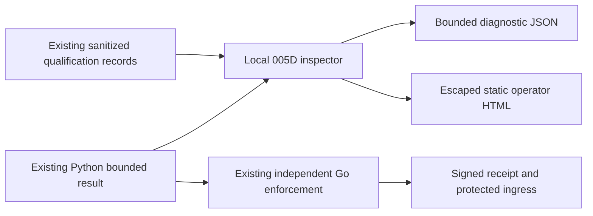

# Task 005D — claim-level freshness and evidence reporting

## Scope and design

Baseline: `2b09cb68806493019cbd1680373f71fa42a44c80`. **005D IMPLEMENTATION COMPLETE / OFFLINE REPORTING QUALIFIED.** The local operator inspector derives explainable claim-level reports from existing bounded Python verification results. It adds no policy, claim language, evidence source, endpoint, protected response field, score-based authorization or source retrieval. The two-policy, nine-form language and one-to-eight-claim limit remain unchanged.

The existing `004g.v1` result already binds original text/digest and ordered grammar mappings to a canonical `004b.v1` comparison result. `ClaimResult` validates comparison verdict/reason, evidence requirements, fixed source URL/mode, evidence identity, observed version and timestamps. The reporter revalidates those existing Python models and uses their comparison verdicts; it does not parse source content or perform a second fact-verification algorithm. Invalid mappings/bindings invalidate numerical reporting. A valid original request can still identify ordered grammar claims for null-score `INVALID_RECORD` entries.

The original enforcement path remains authoritative: Go independently validates grammar, source/time/request bindings and aggregate results before signing; protected ingress validates receipt v2 and the minimal response before delivery. The reporting package is not imported by any enforcement application/hook. Its output always has `authorization=false` and a diagnostic basis. It neither reconstructs Go validation nor independently revalidates HMAC receipts. A trusted Python result is sufficient for a diagnostic score, not proof that ingress released it. Invalid or fabricated local input cannot acquire evidence authority from this report schema.



## Report contract

The strict frozen Pydantic output schema is `005d.claim-report.v1`. Unknown fields, wrong types, arbitrary percentages, wrong source-policy combinations and invalid ordinal/digest/time bindings are refused. JSON and static HTML each stay within 65,536 bytes; the local CLI bounds input to the same size, rejects duplicate/nonfinite/invalid UTF-8 JSON, and creates output files exclusively. It never overwrites input, existing reports or historical evidence.

| Report field | Meaning |
| --- | --- |
| `schema_version`, `authorization` | Fixed v1 identifier and literal false |
| `basis` | `python_result_diagnostic`, `qualification_diagnostic` or `invalid_input` |
| `report_status`, `report_reason` | COMPLETE/INCOMPLETE reporting state and a fixed reason; completeness of a diagnostic record is not factual authorization |
| `input_sha256`, `record_index` | Digest of the supplied input serialization; optional 0–15 historical observation index |
| `evidence_profile` | Trusted operator-selected `fixture` or `live`; never selected by model/browser |
| `candidate_sha256`, `coverage`, `verdict` | Original candidate binding and existing Python/recorded result, when available |
| `generated_at`, `evaluated_at` | Local report creation and original verifier evaluation time, separately |
| `claims` | Ordered list of at most eight entries; no candidate or source text |

| Claim field | Meaning and bounds |
| --- | --- |
| `claim_id`, `claim_index` | Existing `c001`–`c008`; one-based original order, never sorted by verdict/source |
| `policy_id`, `candidate_sha256` | Existing fixed policy and original candidate digest |
| `coverage`, `verdict` | Existing grammar coverage and per-claim comparison; insufficient or invalid records do not default to support |
| `freshness_score`, `score_reason` | Exact 100, 0 or null, with a fixed explanation category |
| `evidence_mode` | Actual `fixture`, `tavily_live`, `pypi_live`, or null when not available |
| `source_id`, `source_url` | Fixed policy registry label `python-windows` / `pypi-requests`; URL only from validated recorded evidence |
| `observed_at`, `evaluated_at` | Existing aware observation timestamp and original verifier `checked_at`, or null |
| `observation_age_ms`, `observation_time_status` | Nonnegative truncated integer milliseconds up to 60,000 when measurable; explicit future/invalid/not-recorded categories otherwise |
| `observed_version`, `evidence_digest` | Existing canonical numeric version and evidence-content SHA-256, or null |
| `origin_published_at` | Always null in v1; publication/update time is not established |

`source_id` is a diagnostic name for the existing fixed policy source, not a new source authority. A valid claim with unavailable evidence still identifies its expected policy/source but has null observed metadata. Unknown sources, wrong identity/mode, absent requirements, malformed/ambiguous evidence and failed bindings cannot yield numerical scores. Complete grammar does not imply sufficient evidence. A valid neighboring claim can have a diagnostic score while another is unscored; this cannot authorize the combined answer.

Unsupported language is refused atomically by the existing grammar. A paraphrase or supported sentence with unsupported neighboring prose yields `coverage=UNCERTAIN`, `report_reason=UNSUPPORTED_LANGUAGE`, no admitted claim mappings and no numeric scores. The reporter does not invent partial claim IDs or claim contents from hashes.

## Evidence-relative score and time

| Existing valid evidence decision | Score | Explanation |
| --- | --- | --- |
| SUPPORTED | 100 | `MATCHED_OBSERVATION`: admitted version matched the valid observed version |
| CONTRADICTED | 0 | `OLDER_THAN_OBSERVATION`: existing policy established the bounded older-version contradiction |
| INSUFFICIENT / ahead of source | null | No meaningful supported/older score; `CLAIM_AHEAD_OF_SOURCE` preserves uncertainty |
| Missing, malformed, expired, ambiguous or mismatched evidence | null | Fixed existing failure category, `SOURCE_MODE_MISMATCH` or `INVALID_RECORD` |
| Unsupported grammar / incomplete historical provenance | null | No admitted mappings or `NOT_RECORDED`; no partial approval |

V1 uses 100/0/null because these policies establish equality, older contradiction or uncertainty. Intermediate percentages would fabricate precision. The score is not a probability, model confidence, general correctness estimate, origin-freshness guarantee or new authorization input. Fixture scores visibly retain `fixture`; live records retain their actual source mode and timestamps.

`evaluated_at` is the original verifier's trusted `checked_at`, not the moment the report is opened. The report uses the existing Python -2..60-second observation window at that time. If the age is nonnegative, it reports truncated integer milliseconds; a tolerated negative age is `FUTURE_WITHIN_TOLERANCE` with null age, never a fabricated zero. Out-of-window observations are `INVALID` and unscored. Go retains its additional request-start and observation/evaluation ordering checks; this diagnostic does not establish those checks or override them.

`generated_at` records local rendering time separately. Viewing a historical snapshot does not make its 100 a current verification. Application observation time, observation age and remote publication/update time are different. Neither a Tavily extraction nor a PyPI response timestamp establishes origin freshness. No publication time is inferred from an observation timestamp, version or digest.

## Historical qualification imports and presentation

`--kind qualification` accepts existing `004gl.observations.v1` records, including the `verifier` section of 005C `observations.json`. The selected record must be completed, bounded and ordered. Known policy/source evidence metadata is revalidated before projection. These historical exports omit original mappings, full comparison/requirement flags and `checked_at`. Even a separately reviewed ALLOW therefore produces a diagnostic `INCOMPLETE / NOT_RECORDED` report with null scores/evaluation time/age. Recorded verdicts and valid source observations can still be displayed. Finished-at telemetry is not substituted for missing evaluation time.

The November 19 Gemini run uses `fixture` source evidence; the November 15 G-L run uses `live` source evidence. Both were imported read-only into new operator artifacts. Their original reports, pending collection fields and previously reviewed qualification status are unchanged. No model/source call, raw source reconstruction or implicit historic refresh is performed. Missing records stay incomplete rather than being reconstructed.

The static HTML inspector shows recorded comparison, score/reason, fixture/live mode, validated source URL, version, times, age status and digest. Unsupported language is identified separately from insufficient evidence. It renders only revalidated sanitized structured data, escapes strings, has no script or remote resource, and uses a restrictive CSP. It is an operator file, not a browser-accessible private endpoint or the Lab/protected response. No Lab component or origin protection changes.

Actual sanitized fixture excerpt from the deterministic `two-supported` report (the full schema also includes digests/times):

```json
{
  "schema_version": "005d.claim-report.v1",
  "authorization": false,
  "basis": "python_result_diagnostic",
  "evidence_profile": "fixture",
  "claims": [
    {"claim_id": "c001", "verdict": "SUPPORTED", "freshness_score": 100, "score_reason": "MATCHED_OBSERVATION", "evidence_mode": "fixture", "source_id": "python-windows", "observed_version": "3.88.7"},
    {"claim_id": "c002", "verdict": "SUPPORTED", "freshness_score": 100, "score_reason": "MATCHED_OBSERVATION", "evidence_mode": "fixture", "source_id": "pypi-requests", "observed_version": "2.88.7"}
  ]
}
```

Those versions are synthetic fixture observations, not current release claims. No raw provider response, Gemini signature, source document, receipt, credential or candidate text is emitted by the reporter.

## Reproduction and evaluation

Use the existing locked virtual environment. These commands use fixed synthetic pages, the actual bounded grammar and existing evidence verifier, with no external service calls:

```powershell
$env:PYTHONPATH = 'tests;services/verifier;services/claim_analysis'
& .venv-003a/Scripts/python.exe tests/claimreporting/evaluate.py artifacts/005d/evaluation-v1
& .venv-003a/Scripts/python.exe -m pytest -c services/verifier/pytest.ini services/verifier/tests_claim_report -q -p no:cacheprovider
```

The evaluator requires a new output directory. It writes only sanitized JSON/HTML and a fixed-case summary. Its 23 cases cover both supported/older policies, two supported claims, mixed contradiction, ahead-of-source, malformed/unavailable/ambiguous/expired evidence, identity/mode failures, paraphrase/neighboring prose, reordered input, reordered/missing/malformed mappings, original/evidence digest mismatches, stale bound evidence and eight stable ordered claims. Reference snapshots use fixed November 19, 2026 12:00 UTC fixture time. The shared synthetic conformance file contains bounded test candidate/result data, not real provider bodies.

Python tests regenerate every snapshot with the existing pipeline and compare the fixed corpus, score/reason/order/source metadata and unchanged authoritative input. Additional controls cover the exact time-window boundaries, report-generation failure, valid-neighbor/unavailable evidence, forged diagnostic scores, invalid inputs, schema types, historical incompleteness, static presentation and CLI bounds/no-overwrite. A Windows-only initial test failure came from blocking asyncio's loopback wakeup socketpair; the guard now permits that loopback mechanism while container execution remains network-disabled. An initial strict-datetime dict-validation mismatch was corrected by revalidating the complete existing JSON wire model. Neither issue changed enforcement.

Go `TestClaimReportsCannotAuthorize` passes each of the 23 snapshots through the existing independent `validateProse`, checks its expected protected decision, then repeats after forged diagnostic 100/authorization and simulated report absence. It also proves extra diagnostic fields are refused by the actual strict evidence wire decoder. These are Go unit checks, distinct from actual gateway qualification and unit race detection. No shared enforcement schema or predicate changed.

Historical import commands executed read only existing records and wrote new files:

```powershell
& .venv-003a/Scripts/python.exe -m verifier.claim_report --input artifacts/005c/live/20261119T092712Z-6d95a336/observations.json --kind qualification --evidence-profile fixture --record-index 0 --output artifacts/005d/005c-supported.json --html artifacts/005d/005c-supported.html
& .venv-003a/Scripts/python.exe -m verifier.claim_report --input artifacts/004gl/live/20261115T103325Z-964a2976/observations.json --kind qualification --evidence-profile live --output artifacts/005d/004gl-supported.json --html artifacts/005d/004gl-supported.html
```

Both reported `INCOMPLETE / NOT_RECORDED`, retaining the actual modes, observation times, versions and digests with null scores. An earlier command used a nonexistent G-L directory and returned the fixed reporting-unavailable error; no input/output was fabricated. Existing ordinary G fixture control counters lack candidate/result evidence and cannot manufacture scored claims.

## Actual validation evidence

The final network-disabled full Python run passed **800 tests**, with one live test deselected and one existing Starlette/httpx deprecation warning. The dedicated 005D suite passed **52 tests**; all 23 fixed evaluator cases passed. Observation milliseconds use exact timedelta division, including a 1.001-second boundary control, to avoid floating-point truncation errors. Native build formatting/vet/unit/race checks passed, including all 23 independent Go decision-invariance cases. Unit race checks do not instrument the running gateway. No Lab component changed, so Lab-specific tests were not rerun. No shared enforcement data contract changed; the added Go file is a regression test only.

Actual native build and full Python commands:

```powershell
docker buildx build --builder epochguard-002a --load -t epochguard-dev:002a -f dev/Dockerfile .
docker run --rm --network none --mount "type=bind,source=$($PWD.Path),target=/src,readonly" --workdir /src/services/verifier -e PYTHONPATH=/src/tests:/src/services/verifier:/src/services/claim_analysis -e PYTHONDONTWRITEBYTECODE=1 epochguard-verifier:004gl python -B -m pytest -c /src/services/verifier/pytest.ini -p no:cacheprovider /src/services/verifier/tests /src/services/verifier/tests_multiclaim /src/services/verifier/tests_gateway /src/services/verifier/tests_live /src/services/verifier/tests_prose /src/services/verifier/tests_bounded_prose /src/services/verifier/tests_live_g /src/services/verifier/tests_claim_report /src/services/claim_analysis/tests /src/tests/modelqualification -q --tb=short
```

Actual protected gateway qualifications, using existing private fixture deployments and the real native loader:

```powershell
& .venv-003a/Scripts/python.exe tests/boundedprose/qualify.py
& .venv-003a/Scripts/python.exe tests/boundedproselive/qualify.py
& .venv-003a/Scripts/python.exe tests/modelqualification/qualify.py --strict-adapter
& .venv-003a/Scripts/python.exe tests/modelqualification/qualify.py --strict-adapter --adapter-batch 1
```

| Check | Actual result / artifacts |
| --- | --- |
| Fixed reporting evaluation | 23/23 passed; `artifacts/005d/evaluation-v1/`, sanitized JSON/HTML and `evaluation.json` |
| Python full / dedicated | 800 / 52 passed; full log `artifacts/005d/python-regressions-qualified-exact-age.log` |
| Pinned native build / Go | Passed format/vet/unit/race and plugin/gateway build; `artifacts/005d/native-build.log` |
| G security/lifecycle | Passed source/coverage faults, request substitution, receipt replay/downgrade/binding, metadata projection, disabled-plugin concurrency, overload, timeout and real restart/recovery; `artifacts/005d/004g.log`, detailed `artifacts/004g/qualification/` |
| G-L offline | Passed; `artifacts/004gl/offline/20261119T101030Z-e74bc52b/`, `artifacts/005d/004gl.log`; fixture-evidence/live-control isolation preserved |
| 005C-T strict standard | 8 expected outcomes; `artifacts/005c/offline/20261119T101102Z-7a59d3a8/` |
| 005C-T signature batch | 6 expected outcomes; `artifacts/005c/offline/20261119T101120Z-2d4fa1b6/`; supported/older/unsupported/paraphrase reached independent Python verification, plain support and neighboring-file refusal preserved |
| Historical imports | November 15 live-source and November 19 real-model/simulated-source observations projected without numeric scores or invented evaluation timestamps |
| Historical immutability | Before/after SHA-256 membership manifests match all 31 files across existing G-L/005C live directories and the preserved November 19 preflight; `artifacts/005d/historical-{before,after}.json` |
| Cleanup | All qualification commands exited 0 and cleaned their disposable stacks; audit found zero containers/networks/volumes for `epochguard-004g`, `epochguard-004gl-offline`, `epochguard-005c`; `artifacts/005d/cleanup-audit.json` |
| Documentation | 47 Markdown files, 313 local links, 53 anchors and 41 repository paths validated; checker unit tests 2/2 and whitespace checks passed |

Both 005C runs identify current source revision `2b09cb68806493019cbd1680373f71fa42a44c80`, fixture evidence, v2 receipts, completed cleanup and qualification source digest `afc7612f5180ad61f677296880eb3a5adac8b997550ef0972bee3af4fa877caf`. This is the existing 005C harness's selected-source digest, not a new cryptographic attestation of the reporting code or source origin. Stage commands/outcomes are in `artifacts/005d/qualification-stages.json`.

Documentation commands executed:

```powershell
py -3.12 scripts/check_docs.py
py -3.12 -m unittest discover -s scripts -p test_check_docs.py
git diff --check
```

No new live Gemini, Tavily or PyPI requests or changes to November 15/19 qualification reports were made. Offline harness timings are test observations, not performance qualification. Runtime evidence outputs and signing/ingress contracts are unchanged.

## Changed-file inventory

| Files | Purpose |
| --- | --- |
| `services/verifier/verifier/claim_report/{__init__,contract,derive,importers,presentation,__main__}.py` | Separate strict report, existing-result projection, incomplete historical import and bounded local JSON/HTML CLI |
| `services/verifier/tests_claim_report/{conftest,test_reports}.py` | Offline reporting, time, metadata, failure, injection, CLI and presentation regressions |
| `tests/claimreporting/{__init__,fixtures,evaluate}.py` | Fixed synthetic corpus and reproducible sanitized evaluation |
| `tests/conformance/005d-reporting.json` | Shared 23-case Python/Go reference snapshots and diagnostics |
| `plugins/epochguard/claim_report_test.go` | Independent Go decision invariance and wire-isolation tests only |
| `dev/Dockerfile.checks` | Include new reporting tests in the network-disabled Python CI selection |
| `README.md`; `docs/{architecture,security,evaluation,operations}.md`; `services/verifier/README.md` | Current reporting capability, boundaries and reproduction |
| `docs/task-005d.md` | This schema, methodology, evidence and limits |

## Residual limits

The reporter trusts local operator context, Python evidence records and recorded clock values. Valid JSON/hashes are not source authentication or proof of Go authorization. Incomplete historical exports intentionally cannot be fully rescored without new data; none is invented. Input/output bounds can refuse otherwise legitimate large records. The reporting CLI can fail to write local files without affecting gateway decisions.

Claim identification remains the existing nine-form language; arbitrary LLM identification is unqualified. The score alone does not satisfy the Tavily Stale-Answer Detector challenge. General factual verification, origin freshness, model confidence, real-model-plus-real-source execution, protected caching, streaming, production authentication and production readiness remain unqualified. No new live or production capability follows from offline reporting success.
