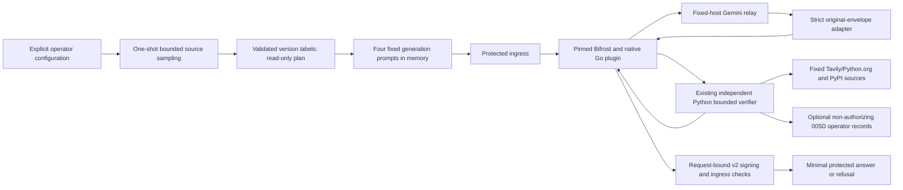

# Task 005E — combined Gemini and live evidence qualification

## Scope and status

Baseline: `ffa9c80cb515938763171f3a9c0ba24762177678`. **005E IMPLEMENTATION COMPLETE / COMBINED LIVE QUALIFICATION PENDING.** The independent 005E harness composes strict 005C-T adaptation, pinned Bifrost/native EpochGuard, the existing G-L evidence pipeline and protected receipt-v2 ingress. Implementation and validation used simulated Gemini HTTP and fixture source transports only. Combined live qualification remains pending separate authorization and execution.

The November 15 real-source run used a controlled provider; the November 19 real-Gemini run used simulated evidence. Neither execution exercised real Gemini and real sources together. Their artifacts and reviewed assessments are unchanged. Offline success here does not fill the combined live evidence cell or qualify arbitrary prose, production deployment or origin freshness.

## Architecture and trust boundaries



The offline and live compositions share the same ingress, gateway, adapter and verification code. Offline sources use the real existing source parsers over mock HTTP transports, correctly labeled `fixture`; the live factory uses the existing fixed retrievers with `tavily_live`/`pypi_live`. Simulated evidence is never relabeled as live. Trusted runtime configuration alone selects the mode; prompts, inference headers, provider metadata and client parameters cannot select sources or live execution.

Default `compose.verify.005e.yaml` has only internal client/private networks, no secrets, no published ports and no external calls. The separately opted-in overlay adds distinct model/evidence egress networks only to relay/verifier respectively. It does not expose management, verifier, gateway, relay or provider ports. The client joins only the client network and tests that private services are unreachable. A controlled provider remains responsible for source-free readiness, no-plugin and provider-error controls; it does not replace model-generated candidates.

The relay inherits the existing fixed Google HTTPS host, request/body validation, cost admission, cancellation/deadline behavior and strict original-envelope adapter. Its trusted plan supplies bounded scenarios through instance-local prompt/allowlist data; ordinary 005C defaults and live allowlist remain unchanged. No generated text is replaced by the intended text. Original text is validated before lossy conversion; complete decoded text is preserved in the minimal Gemini projection, and the opaque signature has no evidence authority.

The new trusted `combined_qualification_diagnostics` switch reuses the existing private fixed-enum/request-hash sink for explicit `004g.v1` prose with receipt v2. It permits fixture/live configurations while preserving the existing source-mode/test-only checks. It is mutually exclusive with the original `qualification_diagnostics`, whose fixture-only restriction remains unchanged. Invalid configurations clear the active policy. This changes diagnostic configuration only: candidate eligibility, grammar, source policies, verdict aggregation, fallback rules, receipt fields/signing and protected response schemas are unchanged. The sink remains 0600 tmpfs, capped at 64 KiB/16 stages per exchange, with diagnostic failures unable to change decisions.

Only the existing independent Python policy evidence and Go validation can lead to signing. Only protected ingress can release the buffered minimal response. The harness, source sampling, source/image digests, model expectations, native stage records and optional 005D scores are non-authorizing. A forged report/score cannot mint a receipt or convert a contradiction into ALLOW. The private verifier HTTP hop and trusted host/operator/gateway/adapter assumptions remain; no external source authentication or production client authentication is added.

## Sampling and scenario design

Before creating the model relay, the host starts only the verifier and explicitly invokes the existing one-shot preflight. It validates the two fixed source observations using the existing parsers, identity, mode and -2..60-second observation window. Only canonical numeric version labels enter the plan. Scraped content is never interpreted as instructions. A Python observation for which no admitted older version can be constructed makes the run inconclusive before generation.

The read-only plan stores only validated source metadata, its creation time and the trusted runtime-configuration digest. It never stores prompts or generated answers. Relay/client reconstruct four fixed prompts in memory: both sampled labels, one older Python label with the sampled PyPI label, supported text plus unsupported neighboring prose/forged policy text, and an out-of-grammar paraphrase. Real Gemini must generate the evaluated text. The strict adapter cannot repair refusals, normalize language, concatenate parts or select a candidate.

Actual verification retrieves new observations rather than authorizing from the sample. Any changed observed version is recorded as `source_changed_since_sampling`; a source change or unexpected model response cannot become the intended successful live qualification through retries or fixture substitution. The offline drift control deliberately produces a safe 403, records the changed source and sets `qualification_conclusive=false`. Its expected negative result is a passing offline control, not a conclusive live run.

Plans bind runtime configuration and expire after 300 seconds. Source-free readiness runs after sampling and must leave the post-sampling source counters unchanged, with zero model submissions and zero verification pipeline records. Health checks do not claim source health.

## Authorization, budgets and failure handling

Live execution requires all of: explicit `--live`, independent `EPOCHGUARD_005E_ALLOW_MODEL=1` and `EPOCHGUARD_005E_ALLOW_EVIDENCE=1`, a complete current offline suite, valid operator settings and separate private model/Tavily secret files outside the repository. Source startup also retains the existing 004E/G opt-ins, trusted live profile, no source overrides and runtime-file-only key loading. Model startup retains the existing process-only native `env.*` secret reference. Unrelated inherited credentials/flags are stripped; no existing host key is silently selected. The example settings intentionally have invalid null rates/caps until an operator supplies reviewed values.

| Resource / boundary | Fixed limit or behavior |
| --- | --- |
| Live model submissions | Maximum 4, exactly the four named scenarios; no automatic retry/fallback |
| Offline model submissions | At most 6 per disposable batch; separate simulated processes, never paid-budget resets |
| Source retrievals | At most 3 per policy/process, shared by sampling and verification; no reset endpoint |
| Standard successful source accounting | One sampling plus supported plus older comparison = 3 per source, 6 total; unsupported grammar uses no retrievals |
| Model admission | Existing per-request/run USD reservations, `(request bytes + 1024) * input_rate / 1e6 + output_limit * output_rate / 1e6`; failures/cancellation retain reservation |
| Source admission | Operator-provided per-request reservations for Python/PyPI; require `3 * (python_request_usd + pypi_request_usd) <= max_source_run_usd`; exact decimal accounting, retained before I/O |
| Output / body | 128–1024 model tokens, 8192 request bytes, 65,536 original response bytes; strict unchanged adapter limits |
| Provider / native provider | Existing 15-second relay and 20-second native network ceilings |
| Evidence | Existing Tavily API 19s, retrieval 20s, PyPI 4s, evidence work 26s |
| Go / ingress / client | Verifier HTTP 30s; live remaining-work cap 40s from request start; ingress 44s; client exchange 48s |
| Process lifetime | 300-second model/source admission lifetime; private role process timeout 260s |
| Offline admission record | Full seven-batch suite, current selected-source digest and exact immutable native/combined image IDs, completed cleanup; maximum age 24 hours |

Source reservations supplement the existing three-call `BudgetedSource`. Context-local preflight/verification labels distinguish sampling from verification without resetting counters. A returned Page counts completed even if subsequent policy validation rejects it; neither completed retrievals nor reservation estimates prove billing, inference, origin fetching or publication freshness. Remote work may continue after timeout/cancellation. Provider-side spend controls and correct operator rates remain necessary; these are not hard billing guarantees.

The controller pins captured image IDs into Compose and checks running Python source digests against the checkout before sampling and generation. Changed source code during a suite invalidates its admission record. These are reproducibility/admission checks, not factual evidence. No successful offline suite record is written before cleanup. Source sampling failure aborts generation; partial startup/failure still attempts owned-project cleanup and retains sanitized failure observations. Live mismatches remain collected/inconclusive or failed records requiring independent review, never live PASS.

A per-checkout exclusive ownership file rejects simultaneous invocations. Existing project containers are detected before startup and are not cleaned by a non-owner. The controller never automatically restarts live relay/verifier processes to reset budgets. Stale owner files after host termination require inspection; coordination across different checkouts/manual Docker operations remains a trusted-operator responsibility, not a globally atomic lease or billing barrier.

## Sanitized report contract

`005e.suite.v1` identifies the source revision, selected-source and runtime-code digests, immutable image IDs, batch set, mode/policy/receipt, creation time, offline result and cleanup state. It links per-batch `005e.gateway.v1` records. Live collection remains `COLLECTED; NOT APPROVED` / pending independent review; offline results remain combined-live pending.

Each batch records public model configuration and its digest, real/simulated mode, invocation totals/completion status, original/projected text digests and exact correspondence, source modes/counters/reservations with phase labels, candidate hashes, native request-stage correlations, independent verifier coverage/verdict/evidence records, protected status/outcome and approved-content digest. Only a released supported answer may have an approved-content hash. Native and Python observations are correlated by request hash/candidate and ordered verifier records; extra or incomplete records cannot manufacture successful collection. Client classification checks the exact minimal envelope and absence of internal diagnostic headers.

Receipt-v2 checks occurred inside the actual protected ingress; reports do not export or independently revalidate raw receipts. Source observations retain their application observation times, not an inferred origin publication date. The strict adapter's correspondence and structural assertions depend on its trusted execution; exported hashes do not independently authenticate Google, Tavily or source origin.

Where the complete result exists in memory, optional `005d.claim-report.v1` records are derived without persisting the candidate/result body. Reporting errors are counted separately and cannot change the original returned verification result. A numeric score is never consulted by Go or ingress. No raw prompts, generated responses, reasoning/signatures, source bodies, credentials, HMAC receipts or arbitrary exception/service-log text is exported. The ordinary public protected response remains unchanged.

## Reproduction

Use the pinned dependency images/build order in [operations](operations.md#prerequisites-and-build-selection): native, verifier C/E/G/G-L, model 005C, then the new combined image. Use the Docker builder that owns local unpublished base tags; initial dependency downloads are separate from network-disabled tests. Actual implementation builds used:

```powershell
docker buildx build --builder epochguard-002a --load -t epochguard-dev:002a -f dev/Dockerfile .
docker buildx build --builder desktop-linux --load -t epochguard-model:005c -f dev/Dockerfile.model .
docker buildx build --builder desktop-linux --load -t epochguard-combined:005e -f dev/Dockerfile.combined .
$env:PYTHONPATH = 'tests;services/verifier;services/claim_analysis'
& .venv-003a/Scripts/python.exe tests/combinedqualification/qualify.py
```

The default command runs all seven disposable offline batches and writes a unique `artifacts/005e/offline/<UTC>-<random>/` directory. It cannot make real provider/evidence calls, does not need credentials or current release versions, and cleans each stack/signing volume before the next batch. CI adds the new tests to its existing network-disabled Python selection; no live flags are set in CI or Lab.

### Future separately authorized live run

No live execution is authorized by this implementation. For a future operator-approved run, independently verify a native Gemini model's availability/rates and source pricing/spend caps, copy `dev/combined/settings.example.json` to a new public configuration file and replace every null with reviewed finite values. Keep `strict-005ct` and four model requests. Build/run the full offline suite for these exact sources/images within 24 hours; an old 005C/G-L report, changed image or incomplete batch set cannot admit live execution.

Create two new private runtime credential files outside the repository using the checked Windows ACL procedure in [the existing model guide](real-model-qualification.md#authorized-model-to-gateway-run): remove inherited ACLs, grant only the current user and check `icacls` success before writing. Use secure input; never place secret values in command arguments, tracked JSON, environment dumps or resolved Compose output. Do not reuse unrelated host keys or broaden ACLs if Docker mounting fails. Model and source files must be distinct and contain bounded ASCII credentials. Once both model and evidence execution have been explicitly authorized, the future command is:

```powershell
$env:EPOCHGUARD_005E_ALLOW_MODEL = '1'
$env:EPOCHGUARD_005E_ALLOW_EVIDENCE = '1'
try {
    & .venv-003a/Scripts/python.exe tests/combinedqualification/qualify.py --live --settings artifacts/operator-005e-settings.json --offline-preflight artifacts/005e/offline/<approved-run>/report.json --model-secret $modelSecretFile --evidence-secret $sourceSecretFile
} finally {
    Remove-Item Env:EPOCHGUARD_005E_ALLOW_MODEL -ErrorAction SilentlyContinue
    Remove-Item Env:EPOCHGUARD_005E_ALLOW_EVIDENCE -ErrorAction SilentlyContinue
}
```

The angle-bracket path is a placeholder, not an executable preselected paid run. Keep an outer `finally` for the explicitly created secret files and empty private directory, following the existing ACL/secret procedure. The runner removes its disposable receipt volume but does not delete operator-owned credentials. Do not retry an unexpected model response or changed source automatically. A successfully collected live report still needs independent review and cannot retrospectively combine earlier runs.

Emergency cleanup uses no credential, interpolation or startable service:

```powershell
docker compose --env-file dev/lab.compose.env -f compose.verify.005e.cleanup.yaml down --volumes --remove-orphans
```

Inspect task-owned containers/networks/volumes and retained evidence first. If an interrupted process left `artifacts/005e/owner.lock`, remove that exact file only after confirming no 005E invocation is active and cleanup completed. Do not remove another operator's lock or stop unrelated projects.

## Offline test evidence

The fixed suite uses 22 protected client cases plus an expected failed-sampling control. Synthetic version labels are explicitly fixtures, not current releases:

| Batch | Cases / expected observations |
| --- | --- |
| `standard` | Supported 200/ALLOW, older 403/REJECT, unsupported prose and paraphrase 503/UNAVAILABLE, ambiguous native envelope 502/PROVIDER_ERROR, Gemini HTTP failure 400/PROVIDER_ERROR, missing plugin 503/INGRESS_REFUSED, controlled provider error 400/PROVIDER_ERROR |
| `faults` | Source unavailable, malformed source data and budget exhaustion each 503/UNAVAILABLE |
| `identity` | Wrong source mode and wrong source identity each 503/UNAVAILABLE |
| `clock` | Observation older than 60s and future beyond tolerance each 503/UNAVAILABLE |
| `envelopes` | File neighbor, same-part file, second candidate, detached signature, thinking and tool each refused before conversion with safe 502; no verification retrieval beyond sampling |
| `drift` | Changed source yields safe 403 and explicit inconclusive qualification; no replacement/repair |
| `sample-failure` | Sampling 503 retained, one failed Python retrieval, zero PyPI/model calls and no gateway generation startup |

Unit tests additionally cover dual authorization before Docker/secret access, invalid budgets/settings, source identity/plan binding, stale preflight, one-shot sampling replay, retained cancellation reservations, source/model admission exhaustion, current runtime binding, concurrent ownership, cleanup after partial startup and foreign-project non-ownership, optional-report failure, and forged diagnostic scores unable to replace contradiction evidence. Existing G/G-L request substitution, receipt replay/downgrade, metadata, concurrency, timeout and lifecycle suites remain separate actual gateway checks; they are not simulated plugin loading.

The first full seven-batch suite passed at `artifacts/005e/offline/20261119T114908Z-20afb075/`. Subsequent source/image binding and report-forgery checks produced a new suite at `20261119T115534Z-512d8016`. Final review identified that a native-stage collection failure could discard already collected source/model observations. The controller now writes those observations first, writes stages separately and has a dedicated partial-failure regression; it does not rewrite an evidence file or change enforcement. The final suite below includes this correction.

## Actual validation results

The final combined run is `artifacts/005e/offline/20261119T120933Z-e3c2e741/`. All seven batches passed their expected controls and completed cleanup. It contains 22 protected client outcomes: one ALLOW, two REJECT (including intentional drift), nine UNAVAILABLE, nine PROVIDER_ERROR and one INGRESS_REFUSED. Twenty simulated model submissions and 16/15 simulated Python/PyPI application retrievals were recorded across disposable batches; all real model/source call counts were zero. Drift and failed sampling remain explicitly inconclusive as intended negative controls.

Source revision is `ffa9c80cb515938763171f3a9c0ba24762177678` plus the tested implementation. The selected-source SHA-256 is `6770fb8098ff4b27a4c04f307a2cf1cb7cb50e95bd35973de7f0f41b16768c78`; the runtime Python source digest is `4091677f1a919c34d73cbc55b4d6c07f9c5c2bbbf94dc379d296406077a90c54`. The standard offline runtime configuration digest is `71143ada86cc0c9e4f812e510c952b7e3a4cb8083edafc021b1e4f2b7cd2ec25`; other batches record their own configuration digests. Both images are recorded/pinned in the suite: native `sha256:03bf6dc4e307381f52ae6a1b4ecb1693b5875219e2a70957d51b22fc03ea5e19`, combined `sha256:0125ac4069385f919534403d4e1d694fc8389efef9e630ee8a26161da5081382`. Current-source, image and complete-preflight checks were recomputed successfully from the final saved records.

| Check | Actual result / evidence |
| --- | --- |
| Final combined native suite | Seven batches, 22/22 protected expectations plus expected sampling refusal; `artifacts/005e/combined-qualified-final.log` and the final suite directory above |
| Combined unit regressions | 30 passed, including observation retention after stage-collection failure |
| Full Python regressions | **830 passed, 1 live test deselected**, one existing Starlette/httpx deprecation warning; `artifacts/005e/python-regressions-qualified.log` |
| Pinned native build | Go format/vet/unit/race and gateway/plugin build passed, including combined diagnostic configuration/source/receipt restrictions; `artifacts/005e/native-build.log` |
| G security/lifecycle | Passed request substitution, receipt replay/downgrade/binding, metadata, source faults, overload/timeout, disabled-plugin concurrency and real restart/recovery; `artifacts/005e/004g-qualification.log`, details under `artifacts/004g/qualification/` |
| G-L offline | Passed fixed source/evidence controls and fixture evidence refusal by live-configured Go; `artifacts/004gl/offline/20261119T115929Z-76971437/` |
| Ordinary / strict 005C | Both 8-case runs passed; `20261119T120000Z-28d5b48b`, `20261119T120018Z-1ec4259e` under `artifacts/005c/offline/` |
| 005C-R/S shapes | 18/18 across all three native batches; logs `artifacts/005e/005cr-{1,2,3}-qualification.log` |
| 005C-T adapter | 36/36 across all six native batches, including exact release, independent verifier outcomes, collisions and native missing-plugin control; logs `artifacts/005e/005ct-adapter-{1,2,3,4,5,6}-qualification.log` |
| 005D reporting | Its full 52-test regression selection and existing shared Go invariance vectors passed within the full Python/native checks; new combined score-forgery/report-failure controls also passed |
| Historical preservation | SHA-256 membership manifests match all 31 existing files across the prior G-L/005C live runs and preserved November 19 offline preflight; `artifacts/005e/historical-{before,after}.json`; historical task reports unchanged |
| Cleanup | Zero containers, networks or volumes for 005E/G/G-L-offline/005C and no remaining 005E owner file; `artifacts/005e/cleanup-audit.json` |
| Documentation | Local link/path/heading checks and checker unit tests passed; whitespace checked for all changed/new files |

Race checks cover unit execution, not an instrumented gateway process. The native suite uses the actual pinned converter and `.so` loader; fake orchestration is limited to explicit unit cleanup/failure controls. No Lab/frontend component changed. Old G/G-L/005C paths were unaffected by the final observation-retention change and were not redundantly rerun after it. No test result is a paid or combined live qualification.

Actual full Python command (read-only current source; network disabled):

```powershell
docker run --rm --network none --mount "type=bind,source=$($PWD.Path),target=/src,readonly" --workdir /src/services/verifier -e PYTHONPATH=/src/tests:/src/services/verifier:/src/services/claim_analysis -e PYTHONDONTWRITEBYTECODE=1 epochguard-verifier:004gl python -B -m pytest -c /src/services/verifier/pytest.ini -p no:cacheprovider /src/services/verifier/tests /src/services/verifier/tests_multiclaim /src/services/verifier/tests_gateway /src/services/verifier/tests_live /src/services/verifier/tests_prose /src/services/verifier/tests_bounded_prose /src/services/verifier/tests_live_g /src/services/verifier/tests_claim_report /src/services/claim_analysis/tests /src/tests/modelqualification /src/tests/combinedqualification -q --tb=short
```

Actual regression commands, in addition to builds/default combined execution above:

```powershell
& .venv-003a/Scripts/python.exe -m pytest tests/combinedqualification -q -p no:cacheprovider --tb=short
& .venv-003a/Scripts/python.exe tests/boundedprose/qualify.py
& .venv-003a/Scripts/python.exe tests/boundedproselive/qualify.py
& .venv-003a/Scripts/python.exe tests/modelqualification/qualify.py
& .venv-003a/Scripts/python.exe tests/modelqualification/qualify.py --strict-adapter
1..3 | ForEach-Object { & .venv-003a/Scripts/python.exe tests/modelqualification/qualify.py --shape-batch $_ }
1..6 | ForEach-Object { & .venv-003a/Scripts/python.exe tests/modelqualification/qualify.py --strict-adapter --adapter-batch $_ }
py -3.12 scripts/check_docs.py
py -3.12 -m unittest discover -s scripts -p test_check_docs.py
git diff --check
```

Sanitized commands/exit codes for the broad regression sequence are in `artifacts/005e/regression-stages.json`; the final additional combined run and full Python run have the dedicated logs above. `artifacts/005e/evidence-summary.json` records the final batch/configuration/count comparisons. Every actual gateway run completed cleanup. No live configuration was resolved/printed, and no credentials, raw receipts, prompts, responses or source bodies were collected into these artifacts.

## Changed-file inventory

| Files | Purpose |
| --- | --- |
| `tests/combinedqualification/{__init__,common,relay,sources,runner,report,qualify}.py` | Independent combined configuration/plan, inherited relay, source reservation/composition, private roles, sanitized measurements and owned lifecycle |
| `tests/combinedqualification/{conftest,test_qualification}.py` | Offline budget, authorization, source/collision, ownership/cleanup and report-forgery controls |
| `compose.verify.005e.yaml`; `compose.verify.005e.live.yaml`; `compose.verify.005e.cleanup.yaml` | Internal offline profile, separately authorized dual-egress overlay and cleanup-only manifest |
| `dev/Dockerfile.combined`; `dev/combined/{start-gateway.sh,settings.example.json}` | Separate runtime image, dual-guard launcher and intentionally incomplete operator cost/model template |
| `tests/modelqualification/relay.py` | Instance-local trusted prompt/live allowlist extension; ordinary 005C defaults unchanged |
| `plugins/epochguard/decision.go`; `plugins/epochguard/combined_qualification_test.go` | Separate non-authorizing stage telemetry flag and strict source/receipt/legacy restriction tests |
| `dev/Dockerfile.checks` | Add combined tests to the offline Python selection |
| `README.md`; `docs/{architecture,security,evaluation,operations}.md`; `docs/task-005e.md` | Current capability, trust, execution, cost and evidence documentation |

## Residual limits

The real-source factories, credential wiring and dual live guards have offline tests only; combined paid execution is unqualified. Future source/model availability, prices and source changes may make a run safely inconclusive. Observation timestamps do not prove origin freshness. Application counters are not billing counts, cost reservations are not invoices, and process restarts/manual operators are outside a global spend barrier.

This remains a trusted qualification deployment with private unauthenticated HTTP hops, a trusted structural adapter and a checkout-local ownership lock. It is not a production authentication design, all-route firewall, statistically reliable model benchmark, arbitrary-language verifier, freshness attestation, safe streaming system or protected cache. The two fixed source policies, nine-form grammar, request-bound receipts and existing authorization decisions remain the complete enforcement boundary.
