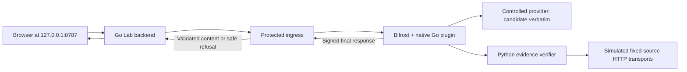

# Verification Lab

The Lab is a local React/TypeScript web application backed by the actual EpochGuard protected gateway. Edit a response candidate, send it through protected ingress, Bifrost, the native Go plugin and Python verifier, then inspect the returned outcome. The Go Lab backend presents safe results; it does not verify facts or authorize answers.

**Runtime mode: offline fixtures.** The controlled provider returns your submitted candidate verbatim. Existing Python.org/PyPI HTTP transports are simulated, while source parsing, independent Go validation, request-bound `004g.receipt.v2` signing and ingress validation are real. There are no commercial model calls, source credentials, live evidence calls or verified cache. The separately reviewed [November 15 real-source qualification](task-004gl.md#reviewed-live-qualification--november-15-2026) is historical evidence, not this interactive session's source data.

## Start on Windows

Requires Git, Docker Desktop running Linux containers with Compose/Buildx, and Python 3.12. The host helper uses only the standard library; no virtual environment, host Node installation or API key is needed.

From the repository root in PowerShell:

```powershell
py -3.12 tests/lab/manage.py up --build
```

Open **http://127.0.0.1:8787**. The host name and port are deliberately fixed; `localhost` and other origins are not accepted. First builds download public pinned Go/Python/Node/npm dependencies. The native host/plugin use the existing pinned Linux/amd64 Go/Bifrost build. Frontend build tools run in the separate Node image; the final Lab image contains only a static Go binary and built static assets, runs without root, and has a read-only filesystem.

If the default Buildx builder cannot resolve GitHub, use the existing [optional project builder](operations.md#prerequisites-and-build-selection):

```powershell
py -3.12 tests/lab/manage.py up --build --builder epochguard-002a
```

Once images exist, omit `--build`. Startup leaves the local Lab running. Stop and remove its containers, networks and disposable signing-key volume with:

```powershell
py -3.12 tests/lab/manage.py down
```

The helper does not read `.env`; it passes the tracked, intentionally empty `dev/lab.compose.env` to Compose, disables default `.env` loading and excludes inherited evidence/model credentials. Vite's environment directory is explicitly an unused path, and credential files are excluded from Docker build contexts. No source secret is mounted. Default `.env` disabling is a documented [Compose setting](https://docs.docker.com/compose/how-tos/environment-variables/envvars/#compose_disable_env_file).

For direct Compose operation, always use the empty environment file:

```powershell
docker compose --env-file dev/lab.compose.env -f compose.lab.yaml up -d --wait lab
docker compose --env-file dev/lab.compose.env -f compose.lab.yaml down --volumes --remove-orphans
```

These commands expect the images to exist; the helper's `--build` performs the complete native -> verifier 004C -> 004E -> 004G -> Lab dependency sequence. No existing G/G-L profile is repointed or enabled for live retrieval.

## Use the workbench

Choose a starting point, edit its candidate if desired, then select **Run verification** or press **Ctrl+Enter**. Expected statuses describe the unedited presets, not predictions for arbitrary edits. Editing clears the previous result so an old approval cannot appear to cover new text. Only the latest response is held in memory; the Lab has no server-side request history, browser persistence or response cache.

| Scenario | Unedited expected outcome | Actual boundary exercised |
| --- | --- | --- |
| Supported claims | 200 / ALLOW | Both fixture observations support the candidate; exact approved content is released |
| Older Python | 403 / REJECT | A numerically older Python claim causes terminal policy refusal |
| Extra assertion | 503 / UNAVAILABLE | Unsupported neighboring prose cannot be authorized |
| Missing plugin | 503 / INGRESS_REFUSED | A fixed no-plugin gateway is still behind protected ingress; no authenticated release is possible |
| Provider failure | 400 / PROVIDER_ERROR | The fixture's system-role control causes a genuine upstream failure, safely projected by G |

Ordinary custom edits use the normal protected ingress. Missing-plugin and provider-failure selections retain their fixed test routes/role even when edited; the UI identifies this behavior. The submitted string is never replaced by a predefined valid answer. A provider error is not a factual verdict, and a safe refusal is not successful verification.

Try a single admitted custom claim:

```text
PyPI reports requests version 2.34.2.
```

Then append `Extra unverified prose.` and submit again. The real grammar should refuse it. The versions here are explicitly synthetic fixture values, not assertions about current releases.

The candidate editor is input, **not an approved response**. The response inspector displays actual Lab HTTP status, protected-ingress HTTP status when available, returned outcome/boundary, a fixed safe error or exact released content, and browser-measured round-trip latency. It never infers a specific internal outage from a generic 503. Only a protected 200 with matching content gets a released-content panel. Unknown upstream shapes, wrong content, malformed/oversized bodies or network failures yield a safe unavailable result.

The JSON tab contains only the safe presentation record. No raw receipt, internal nonce, key, upstream headers, provider ID/model/usage or arbitrary diagnostic text is exposed. Policy/evidence explanations are grounded configuration, not per-claim retrieval telemetry. The architecture diagram is explicitly conceptual; no internal stage durations/events are invented.

## Language and input limits

The Lab uses the unchanged [nine-form bounded language](../services/verifier/README.md#supported-response-languages), one to eight claims. Exact case, internal spaces and punctuation matter. ASCII SP/TAB/CR/LF can separate sentences. Original submitted content is preserved by the backend; ordinary browser textarea editing uses the browser's newline conventions. Backend/API tests separately exercise explicit CR/LF/tab strings.

The browser counts Unicode code points and UTF-8 bytes; input is bounded to 8,192 code points/32,768 bytes. This is a transport bound, not grammar approval: non-ASCII or otherwise unsupported prose still goes to the real gate and cannot authorize release. The backend refuses malformed UTF-8, ambiguous/unknown/duplicate JSON fields, invalid controls, unpaired-surrogate replacement and oversized requests without reflecting input. Empty or out-of-bounds input cannot dispatch.

## Execution and security boundary



Only the Lab publishes `127.0.0.1:8787`. Docker Desktop requires a non-internal host-entry bridge for that port mapping; only the Lab joins it. The Lab also joins the internal client network, while ingress alone bridges client/private networks. Gateway, management, provider and verifier are private and unpublished; the verifier has no external evidence network. The Lab is not on the private network and has only two fixed ingress targets. The host-entry bridge is not a packet-level egress firewall; the trusted Lab binary has no arbitrary outbound URL interface.

Only `GET /api/demo/info` and `POST /api/demo/verify` are application APIs. A source-free `/healthz` checks the Lab process, not verifier/source health. Static `/` and built `/assets/` are served without directory listing. Unknown paths, alternate methods, encoded/query API variants and management/proxy paths are refused. There is no generic proxy, client-selected policy/model/URL/auth token, streaming, fallback selector or browser-accessible fault control.

The backend constructs one fixed OpenAI-compatible request with model `fixture/epochguard-test`, one message containing the exact submitted candidate and `stream=false`. A fixed scenario selects the normal/no-plugin ingress or the provider's system-role failure. The Lab does not enable the provider's prompt-triggered 004C shape controls. Private metadata fault controls remain available only to the host test operator, not the web API. No browser headers or cookies are forwarded. Upstream redirects, environment proxies, compression and POST replay are disabled. The browser receives a newly serialized minimal presentation record, never a raw upstream body/header.

Local protections require the exact Host/Origin, JSON format and a non-simple same-origin request header; no CORS permission is granted. API/static responses use `no-store`, CSP, `nosniff` and no-referrer headers. These are local browser protections, **not production client authentication**. Trusted host/Docker processes can still issue requests. The existing verifier-hop authentication, host/key/configuration and origin-freshness limits remain in [architecture](architecture.md).

Backend admission is four immediate requests, no waiter queue, with a 64 KiB request bound, 256 KiB response bound, 16 KiB upstream header cap and ten-second total upstream timeout. The HTTP server bounds header/body receipt and writing; the browser waits at most twelve seconds. Existing ingress (16 requests, eight-second offline exchange) and verifier (Uvicorn 32, four active evidence checks, five-second work deadline) retain their separate controls. These are bounded application controls, not host CPU/memory isolation or a global gateway execution deadline.

## Tests and demonstration recording

Build/typecheck and frontend presentation tests (Node 24.13 or a compatible toolchain required only for local development tests):

```powershell
npm ci --prefix web/lab --ignore-scripts
npm run build --prefix web/lab
npm test --prefix web/lab
```

The Docker Lab build also runs TypeScript/build and component tests with its test stage network-disabled. Component API mocks test presentation only; they do not substitute for real gateway qualification.

Run the actual stack API, repeatability, metadata, overload, missing-service and recovery checks:

```powershell
py -3.12 tests/lab/manage.py test --build --builder default
```

This runs 21 standard/custom inference checks, a 16-request burst plus private fault/recovery controls, then removes the Lab stack/signing volume even after a failure. With existing images, omit `--build`. Private controls are issued by the host test operator and are never exposed in the web API.

With the Lab running, visible Edge browser checks and screenshots are available on Windows:

```powershell
$env:EPOCHGUARD_LAB_HEADED = '1'
try {
    npm run test:browser --prefix web/lab
} finally {
    Remove-Item Env:EPOCHGUARD_LAB_HEADED -ErrorAction SilentlyContinue
}
```

The test uses a fresh browser profile, restricts page requests to loopback and captures fixture-only `artifacts/005a/lab-desktop.png` and `lab-mobile.png`. No secret-bearing IDE/desktop window is captured. Microsoft Edge must be installed; other Chromium channels require deliberate test configuration changes. See [executed evidence](task-005a.md) for actual outcomes and limitations.

For a short video, use a 1280x900 or wider browser window and record only the Lab page. Show the offline/fixture labels, run the supported preset, edit to a single valid requests claim, append extra prose and show refusal, then exercise older Python, missing plugin and provider failure. Open the JSON record and conceptual architecture caption. End with the separate dated live qualification scope; do not describe the fixture provider as an LLM or the diagram as measured telemetry.
